# 实施计划：BiliCatch 转写质量重构

- 请求：`bilicatch-asr-quality-overhaul`
- 上游：`spec/spec.md`、`spec/clarifications.md`
- 阶段：plan
- 日期：2026-11-15

## 1. 计划原则

- 顺序即优先级：先做「零风险的文字信源」，再做「幻觉修复」，再做「模型换代」，最后做「OCR 与 8B」。
- 每个任务都必须自带可执行的验证路径，且不依赖人工肉眼判断（P6 评测集除外）。
- 每个阶段结束时主链路必须仍然可用；不允许出现「只能跑一半」的中间态。
- 兼容性优先：所有新增字段可选，旧缓存与旧前端可读。

## 2. 任务分解

### T01 数据模型扩展

- 文件：`src-tauri/src/models/transcription.rs`、`src/contracts/*`、`src/features/transcription/contracts.ts`
- 依赖：无
- 内容：`MediaSourceInfo` 新增 7 字段；`TranscriptSegment` 新增 `confidence`/`origin`/`alternates`；新增 `TranscriptOrigin`、`PipelineReport`；全部 `serde(default)`。
- 验证：Rust 反序列化旧 JSON 测试；TS 类型检查。
- 回滚：字段均为可选，无需回滚。
- 验收：AC-8

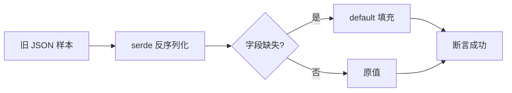

### T02 媒体探测解析器

- 文件：`src-tauri/src/infrastructure/transcription/ffmpeg_preprocessor.rs`
- 依赖：T01
- 内容：解析 `Stream #0:N` 行，提取分辨率/音轨/字幕轨；抽 30 帧计算 `hardSubtitleDetected`。
- 验证：单元测试用固定 stderr 文本；硬字幕判定用两组合成帧 fixture。
- 回滚：恢复为只解析 `Duration:`。
- 验收：AC-1 前置

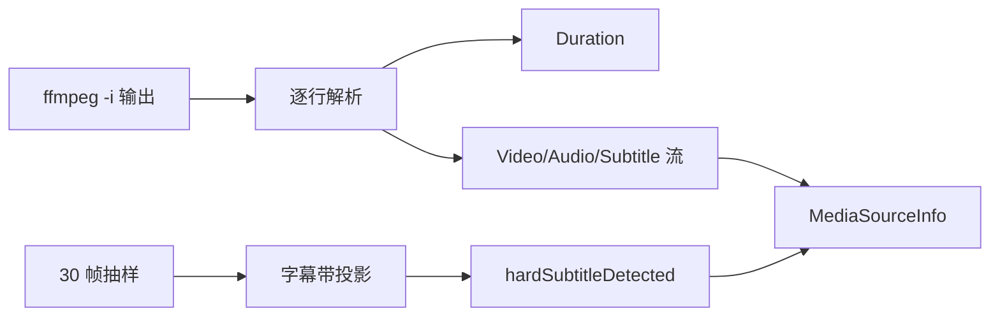

### T03 内嵌字幕抽取

- 文件：新增 `src-tauri/src/infrastructure/transcription/embedded_subtitle.rs`
- 依赖：T02
- 内容：`extract(path, track) -> Vec<TranscriptSegment>`；SRT 解析；ASS 标签剥离。
- 验证：SRT/ASS fixture 解析测试；空字幕降级测试。
- 回滚：删除模块，路由回退到平台字幕。
- 验收：AC-1

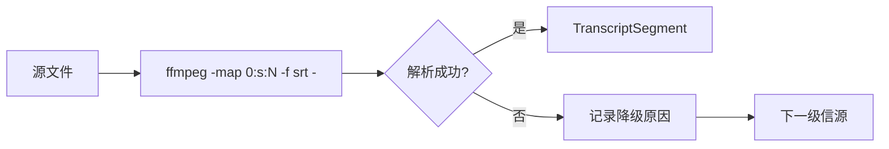

### T04 平台字幕语种校验

- 文件：`src-tauri/src/infrastructure/transcription/platform_subtitle.rs`
- 依赖：无
- 内容：按语种白名单筛选候选；`ai-` 前缀降低置信度。
- 验证：zh/en/ja 三组候选的单元测试。
- 回滚：恢复取第一条。
- 验收：AC-2

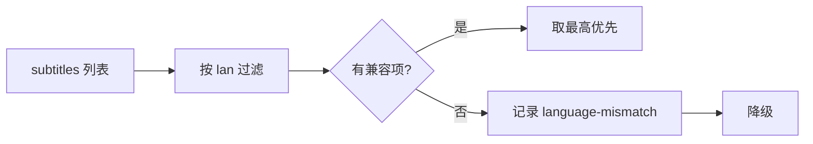

### T05 VAD 接入与切段

- 文件：`runtime.rs`、`ffmpeg_preprocessor.rs`（`silence_points` 填充或改用 sherpa VAD）
- 依赖：T02
- 内容：Silero VAD 切段，段长上限按引擎（AED 55s / Qwen3 20s / 8B 40s）。
- 验证：10s 静音 + 语音 fixture，断言无空段、无跨段。
- 回滚：恢复固定时长切分。
- 验收：AC-3 前置

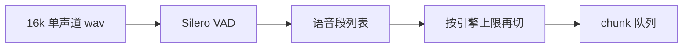

### T06 Whisper 参数修复与默认模型

- 文件：`whisper_sidecar.rs`、`settings/store.rs`、`services/settings/mod.rs`
- 依赖：无
- 内容：新增 `-mc 0`、`-et 2.4`、`-lpt -1.0`、`-nth 0.6`、`--vad`、简体中文 prompt；默认模型改为 AED；中文禁用 `-l auto`。
- 验证：参数拼装单元测试；评测集幻觉段统计。
- 回滚：恢复旧参数。
- 验收：AC-3

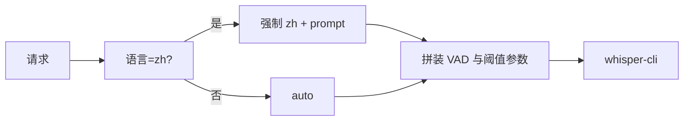

### T07 模型仓库改多文件包

- 文件：`model_repository.rs`、`models/transcription.rs`
- 依赖：T01
- 内容：`ModelPackage`/`ModelFile`；`<id>/<file>.part` 布局；旧单文件兼容读取。
- 验证：本地 HTTP fixture 下载多文件包；旧目录列出测试。
- 回滚：保留旧单文件清单解析分支。
- 验收：AC-9

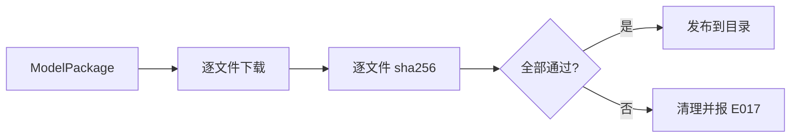

### T08 AED 适配器

- 文件：`fire_red_sidecar.rs`
- 依赖：T07
- 内容：AED 双文件参数 `--fire-red-asr-encoder/--fire-red-asr-decoder`；字级时间戳与置信度解析。
- 验证：JSON fixture 解析测试。
- 回滚：保留 CTC 分支。
- 验收：AC-1/AC-5

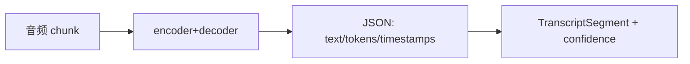

### T09 Qwen3-ASR-1.7B 适配器

- 文件：新增 `qwen3_asr_sidecar.rs`
- 依赖：T07
- 内容：四文件模型、`--qwen3-asr-*` 参数、20s 段上限、热词。
- 验证：JSON fixture；ja/ko 路由测试。
- 回滚：语种回退到 AED（不支持则报错）。
- 验收：AC-1

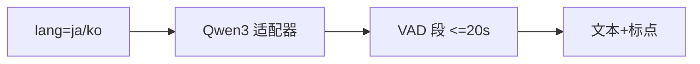

### T10 OCR 运行时 spike

- 文件：`docs/requests/.../artifacts/ocr-spike.md`
- 依赖：无
- 内容：验证 `ort` 与已打包 onnxruntime 是否冲突；不冲突则锁定 `ort`，否则评估 `rten`。
- 验证：最小 demo 能对一张截图输出中文文本。
- 回滚：不成立则改用外部 OCR sidecar。
- 验收：spike 结论写入 artifacts

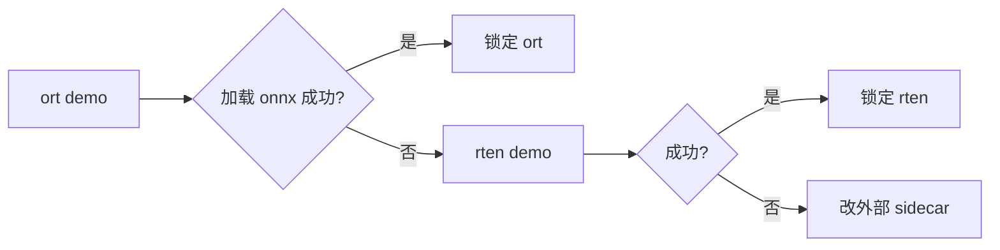

### T11 抽帧与字幕带检测

- 文件：`ffmpeg_preprocessor.rs`、新增 `hard_subtitle_ocr.rs`
- 依赖：T02、T10
- 内容：2 fps 抽帧、ROI 稳定化、像素差门控。
- 验证：合成视频 fixture，断言 OCR 调用次数 < 帧数 50%。
- 回滚：关闭 OCR 开关即回退。
- 验收：AC-4 前置

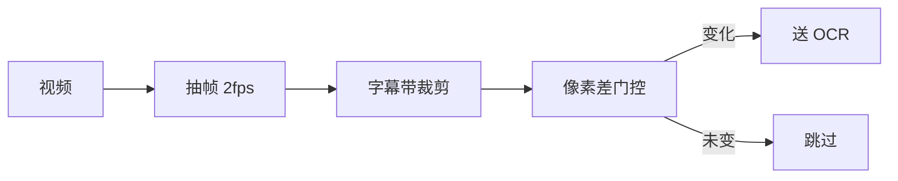

### T12 OCR 引擎与句子合并

- 文件：`hard_subtitle_ocr.rs`、`ocr_engine.rs`
- 依赖：T11
- 内容：det+rec 推理、帧文本去重、句子合并、置信度。
- 验证：固定帧序列 → 期望句子数与时轴。
- 回滚：同上。
- 验收：AC-4

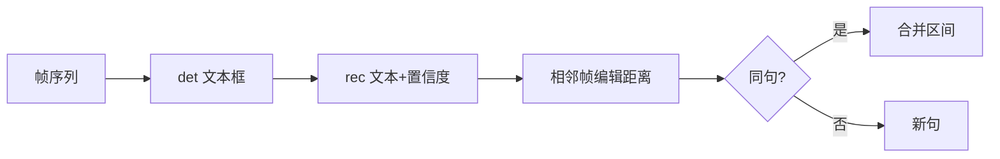

### T13 融合引擎

- 文件：新增 `src-tauri/src/services/transcription/fusion.rs`
- 依赖：T03、T04、T12
- 内容：扫描线对齐、相似度、冲突规则、`PipelineReport`。
- 验证：构造 OCR+ASR 双候选 fixture，断言冲突段与 alternates。
- 回滚：关闭融合即取单候选。
- 验收：AC-5

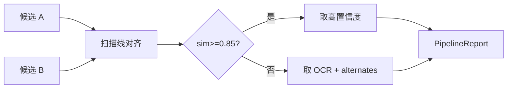

### T14 置信度前端展示

- 文件：`src/features/transcription/*`、`src/locales/*`
- 依赖：T13
- 内容：低置信度标黄/标红、`reviewRecommended` 提示、可选 `[?]` 导出前缀。
- 验证：组件测试 + i18n key 测试。
- 回滚：隐藏样式类。
- 验收：AC-7

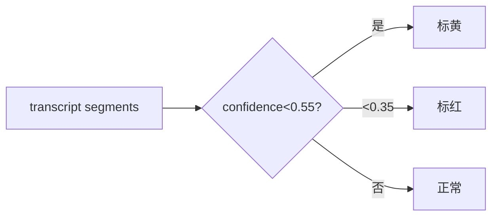

### T15 内存守卫与 E018

- 文件：`models/app_error.rs`、新增 `infrastructure/system/memory.rs`
- 依赖：T08
- 内容：可用内存探测 trait + 平台实现；8B 执行前检查。
- 验证：注入低内存实现，断言 `E018`。
- 回滚：删除检查。
- 验收：AC-6

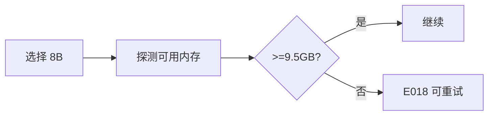

### T16 OpenASR 8B 适配器

- 文件：新增 `openasr_sidecar.rs`、`tauri.conf.json`
- 依赖：T15
- 内容：仅依赖 `transcribe` CLI；`.oasr` 模型包下载与校验；40s 段上限。
- 验证：fake CLI 脚本测试调用与解析。
- 回滚：移除 8B 选项。
- 验收：AC-6

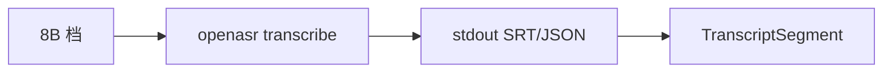

### T17 评测脚本与基线

- 文件：新增 `scripts/asr-bench/{run.mjs,cases.json}`
- 依赖：T06、T08
- 内容：跑固定 10 条素材，输出 `EntityErrorRate`/`HallucinationSegments`/`TimelineMAE`。
- 验证：对已知样本产出稳定数值。
- 回滚：不影响产品代码。
- 验收：AC-3/AC-4

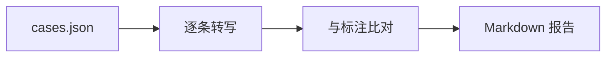

### T18 许可、打包与文档

- 文件：`tauri.conf.json`、`licenses/*`、`NOTICE`
- 依赖：T07~T16
- 内容：新增模型与运行时许可、打包资源清单。
- 验证：构建产物体积与清单一致性检查。
- 回滚：移除新增资源条目。
- 验收：AC-9

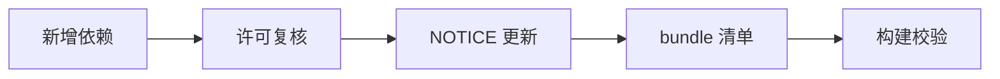

## 3. 依赖与并行

- 严格串行：T01 → T02 → T03/T04 → T05/T06 → T07 → T08/T09 → T10 → T11 → T12 → T13 → T14 → T15 → T16 → T17 → T18。
- 可并行：T03 与 T04；T08 与 T09；T14 与 T15。
- 不建议 workflow 并行：改动集中在同一组文件，合并成本高于收益。

## 4. 测试策略

- 单元测试覆盖解析器、语种匹配、融合规则、模型包校验。
- 集成测试覆盖 L1/L2 路由、取消传播、缓存复用。
- 契约测试覆盖前端 TS 类型与 Rust serde 的字段一致性。
- 评测集（T17）作为唯一的人工精度验收手段。

## 5. 发布与回滚

- 发布顺序：P0+P1 一个版本（止血与拾字），P2 一个版本（引擎换代），P3+P4 一个版本（OCR 与融合），P5 一个版本（8B 可选）。
- 每版保留 `PIPELINE_VERSION`，回滚通过回退版本号 + 保留旧适配器实现。
- 数据兼容：全部新增字段可选，回滚不需要数据迁移。
