# `audio-transcription` 实施计划

## 交付单元标识

- 请求：`bilicatch-asr-v1-1`
- 模块：`audio-transcription`
- 基线规格：`../spec/spec.md`，已于 2026-10-10 批准
- 执行策略：测试先行、单线程主线、按任务逐项验收

## 阅读导航

- 目标：交付模块八的本地音视频转写、模型管理、任务调度、结果编辑导出，以及下载/任务/设置联动。
- 任务总数：11；主线串行任务 9 个，合同稳定后理论上可并行任务 2 个（T04/T05），本次仍顺序执行。
- 高风险任务：T02 模型完整性、T05 sidecar 生命周期、T06 调度与缓存、T07 跨模块自动触发、T11 真实资产烟测。
- 关键依赖：T01 合同与设置 -> T03 状态存储 -> T04/T05 执行适配 -> T06 编排 -> T07/T08 IPC -> T09/T10 UI -> T11 验收。
- 任务状态与执行入口见 `task-board.md`；业务规则以 `../spec/spec.md` 为唯一准绳。

## 全局摘要

实现主线从稳定合同开始：先扩展错误码、设置 schema 和前后端类型，再分别落地模型仓库、任务状态存储、FFmpeg 预处理和固定版本 `whisper.cpp` adapter，随后用应用服务编排平台字幕优先、ASR、缓存、导出和自动转写。Tauri 命令/事件只是薄边界，Vue 通过 feature service 和 Pinia 消费快照与带序号事件。

最大风险不是页面，而是外部资产和进程生命周期：模型必须经过大小与 SHA-256 校验后原子发布；取消要终止进程树并清理临时文件；sidecar 缺失不能阻止应用启动；下载完成触发必须幂等且不能反向污染下载任务状态。

实施前置条件：规格与本计划均获批准；真实 smoke 所需的 Windows `whisper.cpp v1.8.6` 可执行文件、受支持的小型模型和短音频 fixture 在 T11 前可获取。若外部资产暂不可获取，代码与自动化测试可完成，但 AC-04/AC-10 不能判定通过。

## 任务拆解

### T01 合同、错误码与设置迁移

**目标与映射**：建立所有后续任务复用的 Rust/TypeScript 合同；覆盖规格“API 与数据合同”“设置扩展与迁移”“错误与通知”，AC-07、AC-09。

**范围**：扩展 `AppErrorCode` 为 E011-E017；新增转写、模型、结果、进度和命令 DTO；把设置 schema 从 v1 迁移到 v2，加入 11 个字段、默认值、范围与 HTTPS 模型源校验；TypeScript 字段保持 camelCase，与 serde 输出一致。

**实施子项**：先写 v1 fixture 迁移、非法设置、DTO 序列化和 TS 类型使用测试；再实现最小合同；最后整理共享枚举和验证器。不得把 `DownloadTask` 扩展为混合实体，也不得在 Vue 组件中复制 Rust 校验规则。

**完成条件**：旧设置无损读取并补默认值；非法并发数/模型源返回稳定错误；Rust/TS 测试与类型检查通过。

**风险与回退**：迁移失败时保留原设置文件并返回可诊断错误；代码回退只需撤销 schema v2 读取路径，不删除用户文件。

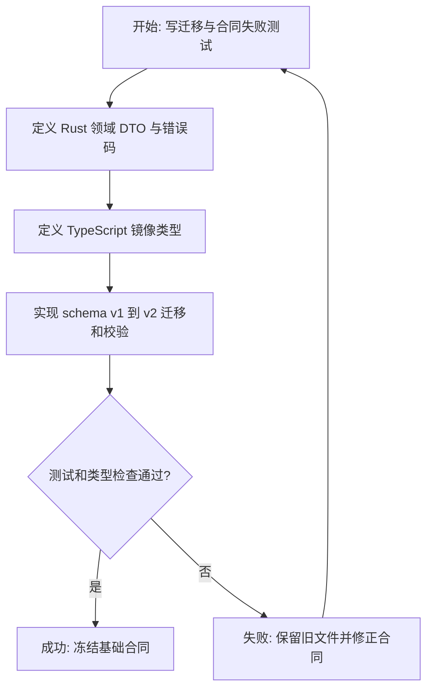

### T02 模型清单与本地仓库

**目标与映射**：完成 Tiny/Base/Small/Medium/Large-v3 的可发现、下载、校验、取消和删除；覆盖规格“模型目录与下载”，AC-03。

**范围**：版本化 manifest 固定 id、名称、文件名、大小、SHA-256 和 HTTPS URL；实现 `ModelRepository`、流式下载、`.part` 临时文件、大小+摘要校验、原子 rename、取消清理、使用中删除保护，以及自定义目录/镜像源解析。

**实施子项**：先以本地 HTTP fixture 覆盖成功、断流、错误摘要、取消和冲突；再实现 adapter；最后接入列表/下载/校验/删除应用服务。下载进度节流，manifest 不接受运行时远端覆盖。

**完成条件**：未校验文件永不显示为可用；取消/失败不遗留可误用模型；Base 默认选择但不静默下载。

**风险与回退**：网络失败只删除 `.part`；已有已验证模型不被覆盖；目录迁移失败继续使用原目录并提示。

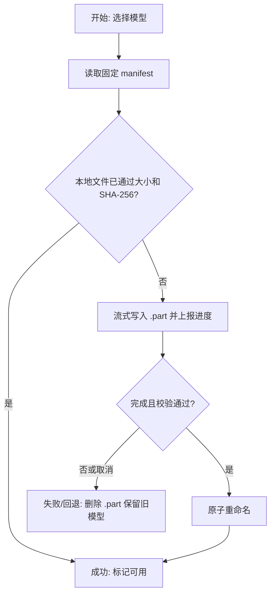

### T03 转写任务状态机、持久化与恢复

**目标与映射**：建立独立 `TranscriptionTask` 聚合、合法状态转换、动作规则、revision/sequence 和崩溃恢复；覆盖规格“转写任务合同与状态机”，AC-05、AC-08。

**范围**：新增 store/manager、JSON 持久化和原子写；状态包含 pending、preprocessing、loadingModel、transcribing、processing、saving、completed、failed、cancelled；实现开始、取消、重试、删除、清理完成任务和启动恢复。

**实施子项**：先写状态表参数化测试、非法转换测试、存储损坏/恢复测试和陈旧事件测试；再实现纯领域转换与仓储；最后接 manager。重启后运行态统一恢复为可重试失败态，终态保持原值。

**完成条件**：每次可见变更递增 revision/sequence；非法动作不改变持久状态；损坏存储有备份/诊断，不静默清空。

**风险与回退**：持久化失败时不发布成功事件；写入使用临时文件+原子替换；下载任务持久化格式不变。

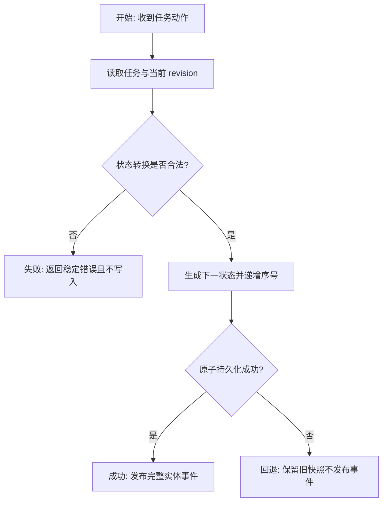

### T04 来源检查与 FFmpeg 预处理

**目标与映射**：统一检查本地音频/视频和已完成下载输出，并生成适合识别的 16kHz 单声道 s16 WAV 分片；覆盖规格“来源选择与元信息”“FFmpeg 预处理与长音频”，AC-02、AC-05。

**范围**：允许 MP3/M4A/AAC/FLAC/WAV/OGG 与 MP4/MKV/FLV/MOV/WebM；复用现有 runner/locator 模式；不超过 30 分钟单文件，超长内容按约 30 分钟并在可行时于静音点前后 5 秒切分；所有临时产物纳入 cleanup guard。

**实施子项**：先写扩展名/媒体探测、命令参数、分片时间轴合并、取消和失败清理测试；再实现 `AudioPreprocessor` adapter。检查阶段不修改源文件。

**完成条件**：非法/不存在/未完成下载来源在创建前拒绝；成功输出规范 WAV；任意异常和取消均清理任务临时目录。

**风险与回退**：静音探测失败时退回固定边界分片；FFmpeg 缺失映射稳定错误，不影响应用启动。

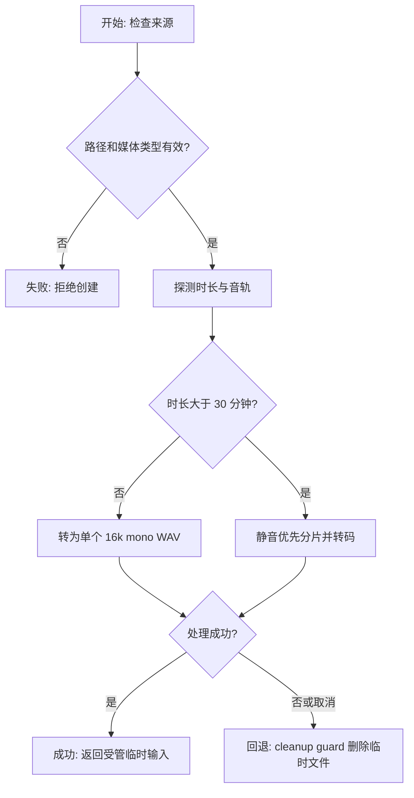

### T05 `whisper.cpp` sidecar 适配器

**目标与映射**：以固定 `whisper.cpp v1.8.6` 执行真实本地识别并解析分段结果；覆盖规格“whisper sidecar”“标点与语言”，AC-04、AC-05、AC-10。

**范围**：实现 locator、能力检测、隐藏 Windows 控制台、CPU 基线、GPU auto/enabled 行为、进程树取消、stdout/stderr 限界采集、进度与结果解析；找不到二进制为 E014，输出不可解析为 E015。

**实施子项**：先写 fake process/fixture 参数、解析、退出码、取消测试；再实现 `Transcriber` adapter；真实二进制测试留到 T11。应用 setup 只注册能力，不在启动时强制解析 sidecar。

**完成条件**：返回带开始/结束时间的规范 segments；取消能终止子进程树；GPU 不可用时 `auto` 回退 CPU、`enabled` 返回明确错误。

**风险与回退**：解析器只依赖已固定版本输出；版本/能力不匹配拒绝执行并保留可重试任务，不降级为伪结果。

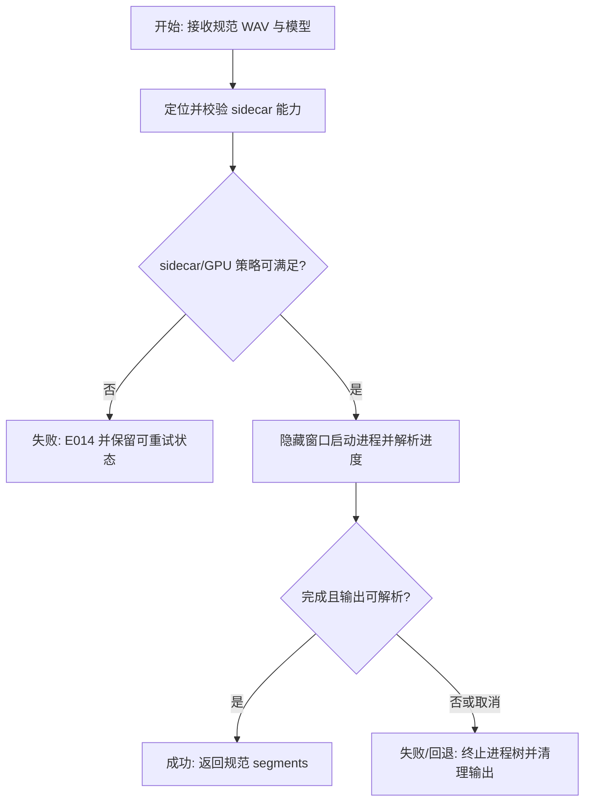

### T06 调度、字幕优先、缓存与结果导出

**目标与映射**：将来源、模型、平台字幕、ASR、缓存、结果修订和五种格式导出编排为完整用例；覆盖规格“调度与资源优先级”“平台字幕优先”“结果、编辑与缓存”“导出与命名”，AC-04、AC-06。

**范围**：独立 scheduler 限制并发 1-3，下载活跃时降低优先级；仅带 BVID/CID 的下载来源尝试平台字幕，Unavailable/Failed 回落 ASR；缓存指纹由绝对路径、大小、mtime、模型、语言、标点组成；保存只能改文本；导出 TXT/SRT/VTT/JSON/Markdown，时间戳与文件冲突规则遵循规格。

**实施子项**：先写调度公平性、字幕三态、缓存命中/强制绕过、分片时间偏移、格式 golden files、编辑 revision 和原子导出测试；再实现应用服务和 ports。识别缓存与渲染格式分离。

**完成条件**：平台字幕失败不会卡死；缓存不因导出格式变化失效；同名导出使用 `(n)` 且不覆盖；保存/打开/复制可从同一结果实体派生。

**风险与回退**：字幕远端合同变化只影响 adapter；导出失败保留上个结果 revision；调度崩溃由 T03 恢复机制接管。

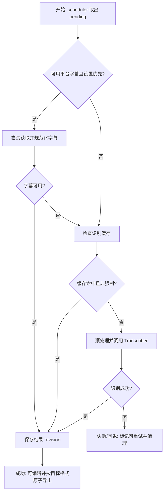

### T07 Tauri 命令、事件、通知与自动转写钩子

**目标与映射**：把应用服务接入 Tauri，并以明确跨域接口处理下载完成后的自动转写；覆盖规格全部 13 个命令、3 类事件、通知和“下载中心联动”，AC-02、AC-07、AC-08。

**范围**：commands 保持薄边界；事件发送完整实体与 sequence/revision；在下载 runner 成功提交后调用幂等 sink，键为 `download:<downloadTaskId>:<outputRevision>`；仅音频/视频输出且设置启用时创建任务；缺模型不静默下载；转写失败不改变下载 completed。

**实施子项**：先写 command contract、事件 payload、幂等触发和失败隔离测试；再在 `lib.rs` 装配 manager/adapters/runner；完成/失败复用通知 port。sidecar 缺失时 setup 仍成功。

**完成条件**：13 个命令可调用且错误结构稳定；事件乱序可由客户端拒绝；自动触发至多一次；既有下载测试不回归。

**风险与回退**：通过显式 completion sink 隔离下载域；禁用设置或移除 sink 即可停止自动创建，不更改历史下载记录。

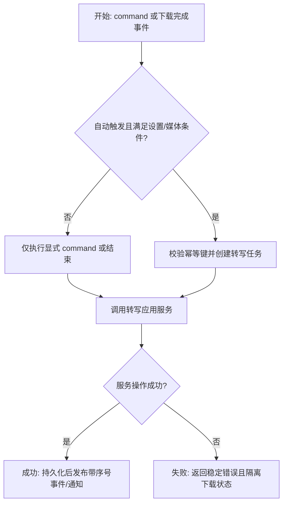

### T08 前端 IPC、事件源与 Pinia 状态

**目标与映射**：建立页面可消费的转写 feature 层；覆盖规格“API 与数据合同”“任务页联合展示”，AC-01、AC-08、AC-09。

**范围**：新增 service、event source、store、格式化器和 `TaskListItem` 判别联合；快照初始化后订阅事件，用 sequence/revision 丢弃陈旧更新；维护表单草稿、模型进度、任务列表、结果 loading/error。

**实施子项**：先写 service 命令映射、乱序事件、删除事件、加载失败和联合投影测试；再实现 feature；在 `main.ts` 注入依赖。组件禁止直接 `invoke/listen`。

**完成条件**：重连/刷新能由快照恢复；重复事件不回退 UI；下载与转写行可在任务页使用统一视图模型但保留各自动作。

**风险与回退**：事件源停止时解除监听；单个查询失败只影响对应状态片段，不清空已有任务。

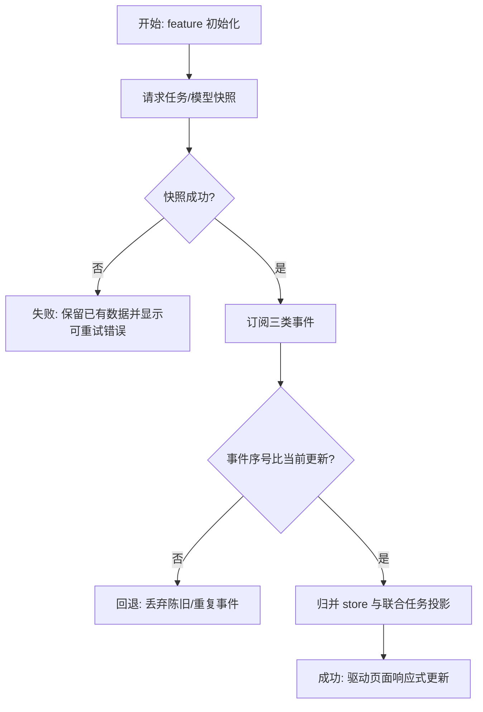

### T09 转写工作台页面与结果编辑

**目标与映射**：实现 `/transcribe` 的实际工作台，而非说明页；覆盖规格“页面与模块设计”“参数表单”“结果、编辑与缓存”，AC-01、AC-02、AC-03、AC-06。

**范围**：路由/侧栏；本地选择与拖放区、已完成下载任务选择；模型/语言/格式/时间戳/标点参数；模型管理对话框；任务状态和进度；结果预览、文本编辑、复制、导出、打开目录、强制重新转写。桌面双栏、窄屏单栏；按钮使用既有图标库和 tooltip；无嵌套卡片。

**实施子项**：先写组件交互和页面流程测试；再按页面设计实现。表单在 inspect 成功后才可提交；模型未安装时引导下载；loading 从动作触发持续到命令返回/对应事件终态；删除模型和清理结果需二次确认。

**完成条件**：键盘可达、焦点状态清楚、窄屏无横向溢出；错误就地显示且可重试；长文件名/长文本不挤压控件。

**风险与回退**：编辑草稿和已保存 revision 分离，保存失败不丢草稿；关闭对话框不取消进行中的模型下载，取消必须显式操作。

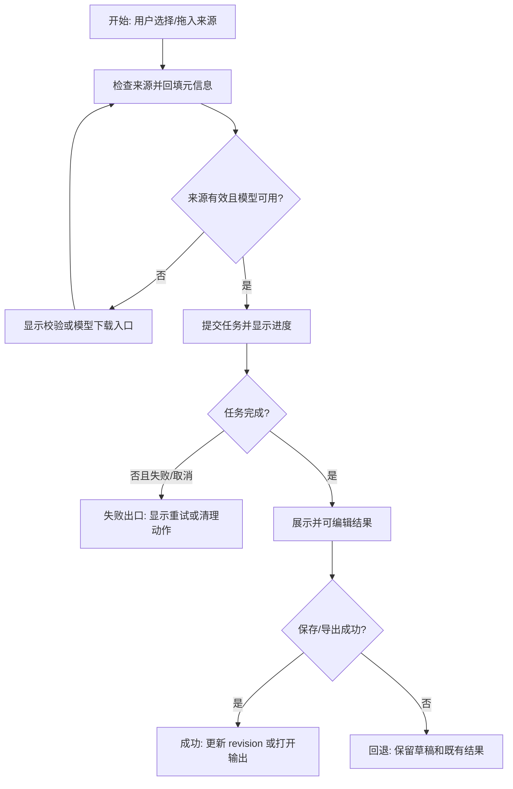

### T10 任务、设置、下载中心与 i18n 集成

**目标与映射**：将转写能力纳入现有产品流程；覆盖规格“任务页联合展示”“下载中心联动”“设置扩展与迁移”，AC-07、AC-08。

**范围**：任务页按 `kind` 渲染下载/转写任务与动作；设置页加入模型、语言、格式、时间戳、标点、平台字幕、自动转写、并发、模型目录、GPU、镜像源；下载创建流程增加“完成后转写”选项和必要提示；补齐中英文文案。

**实施子项**：先写设置 round-trip、联合任务动作分发、下载草稿序列化与 i18n key 测试；再改页面和 feature。镜像源先 trim，再校验 HTTPS 且禁止 query/fragment；并发范围 1-3；自动转写默认关闭。

**完成条件**：既有三种下载模式和任务批量动作无回归；设置重启后保持；转写清理不会删除下载任务或源媒体。

**风险与回退**：联合展示仅在 view-model 层；任一转写组件加载失败不阻断下载任务列表；自动选项关闭即可回到旧流程。

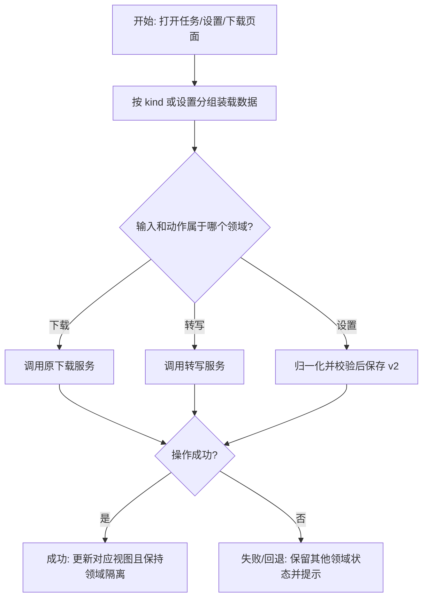

### T11 分发、许可证、真实 smoke 与全量验收

**目标与映射**：证明实现可交付并记录非 Windows 平台交接；覆盖规格“项目脚手架决定”“验收标准”“人工评审与交接”，AC-04、AC-09、AC-10。

**范围**：固定 sidecar 版本和平台命名，更新 Tauri `externalBin`/资源配置及第三方许可证；运行全部单元/集成/构建门禁；Windows 使用真实 sidecar、已校验模型和短音频执行转写、取消、重启恢复 smoke；验证缺 sidecar 时仍可启动；记录 macOS/Linux locator/config 测试与外部打包验证清单；做桌面/窄屏视觉和键盘检查。

**实施子项**：先写可自动化的打包配置/locator 检查；再准备 smoke 脚本或明确命令；最后运行 `npm test`、`npm run build`、`cargo test`、`cargo check` 和 targeted smoke，并生成 verify/review 证据。

**完成条件**：所有自动门禁通过；真实输出非空且时间戳单调；取消无残留进程/临时文件；许可证与平台交接完整。无法取得外部资产时明确阻断 AC-04/AC-10，不能以 mock 代替通过。

**风险与回退**：不把模型打进安装包；移除 sidecar 配置后应用仍能启动并显示缺失能力；分发失败不删除开发环境已验证资产。

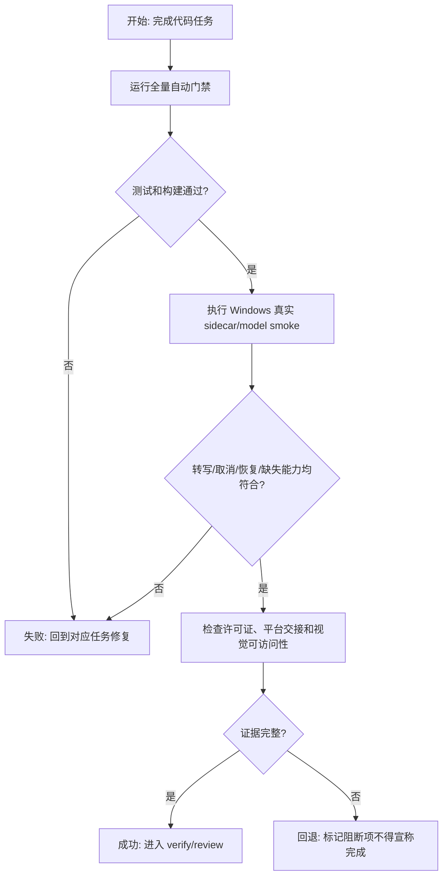

## 功能拆解明细

### 转写表单

字段顺序为来源、模型、语言、输出格式、时间戳、标点；来源必填，其他字段从设置默认值回填。来源控件支持文件选择、拖放和已完成下载任务列表；只接受规格列出的扩展名，后端仍做最终媒体探测。模型为必填下拉框，未安装项保留可见并提供下载动作。语言默认 `auto`；格式默认 `srt`；时间戳和标点默认开启。提交前等待来源检查完成；纯空路径、失效路径、无音轨、未完成下载任务均阻止提交并就地提示。

### 模型列表/对话框

列顺序为模型、预计大小、状态、校验信息、操作。状态包括未安装、下载中、校验中、可用、失败；行内操作为下载/取消/校验/删除。下载进度由事件驱动；删除可用模型需要确认，使用中模型禁用删除并说明原因；空状态展示五个 manifest 项而不是空白页。

### 转写任务与结果

转写任务显示来源名、状态、阶段进度、模型/语言、创建时间、错误和允许动作；没有分页要求，沿用当前任务页滚动策略。结果按 segments 展示时间范围和文本；时间戳只读，文本可编辑；保存后 revision 增长。复制是即时动作；导出有格式选择并使用不覆盖命名；打开目录仅对已落盘输出可用。

### 异步与失败状态

所有按钮 loading 在命令发起时开始，在命令失败或对应成功/终态事件到达时结束。任务和模型错误保持在对应实体上，刷新后可由快照恢复。取消是显式动作；删除模型、删除任务和清理已完成任务使用确认。通知仅用于转写完成/失败，不以频繁进度打扰用户。

## 项目脚手架与初始化策略

这是既有 Vue 3 + Pinia + Naive UI + Tauri v2 工程，不创建新应用或引入 starter。前端沿用 `src/features/*`、页面、路由和依赖注入结构；Rust 沿用 models/commands/services/infrastructure 分层和 trait adapter 方式。执行阶段不得重新初始化 package、Tauri 或测试框架，也不得为模块八引入第二套状态管理、IPC 包装或组件库。

## API 对接与类型策略

正式契约来源是已批准规格中的命令/事件表和 Rust serde DTO。Rust 为所有跨 IPC 类型的权威定义；由于仓库没有自动生成 TypeScript 类型的既定工具，前端在 `src/features/transcription/types.ts` 维护字段同名镜像，并以 contract fixture 测试防漂移。`TranscriptionService` 负责命令映射，event source 负责监听，mapper 只承担错误/日期/联合任务展示归一化。组件不得调用 Tauri API。

13 个命令全部通过现有 `IpcTransport`：来源检查、任务列表/创建/控制/清理、模型列表/下载/取消/校验/删除、结果读取/保存/导出/打开。事件为 `transcribe://progress`、`transcribe://removed`、`transcribe://model_download_progress`，payload 必须包含可判序字段。联调测试覆盖每个命令名、请求字段、返回空态和稳定错误码。

## 依赖关系

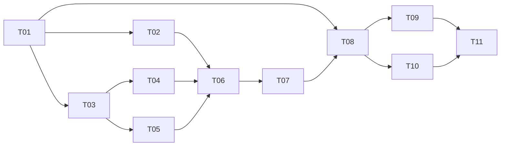

T04 与 T05 在 T01/T03 稳定后无代码依赖，可理论并行；T09 与 T10 共享 store、i18n 和页面测试环境，按顺序执行更稳妥。每个任务只有在其 targeted tests 通过后才解锁下游。

## 整洁性与复杂度控制

- 状态转换、缓存键、导出命名和设置校验均保持为可独立测试的纯函数。
- 外部副作用只能经 ports/adapters；commands、Vue 页面和 store 不拼接 sidecar 参数或写文件。
- 单一 `TranscriptionManager` 管理实体和持久化，单一 scheduler 管理并发；不以全局锁散落协调。
- 优先小模块与领域名词；出现多于两种实现的变化轴才增加 registry/factory。
- 测试 fixture 不能绕过生产验证逻辑；真实 smoke 与 mock adapter 测试分别记录。

## 模式决策与替代方案

采用 Ports and Adapters 隔离 FFmpeg、whisper、文件、网络、字幕、通知；采用显式状态机保护生命周期；采用 scheduler 管理并发；采用判别联合投影任务页。拒绝把转写塞入 `DownloadTask`，因为生命周期和动作不同；拒绝前端轮询/触发自动转写，因为应用退出后会丢事件；拒绝 `whisper-rs`，因为批准方案固定 sidecar，且进程隔离更符合现有 FFmpeg 模式；拒绝运行时拉取远程 manifest，避免供应链和不可重复性风险。

## 代码上下文与影响范围

代码图不可用，已按 `artifacts/code-context.md` 使用 import/mod/构造链恢复上下文。主要新增 `src/features/transcription/`、`src/pages/TranscribePage.vue`、Rust transcription models/services/infrastructure/commands。主要修改 router/navigation/sidebar/main、TasksPage、SettingsPage、DownloadPage 与下载 feature、Rust `lib.rs`/错误码/设置/下载完成 hook、Tauri sidecar 配置和 i18n。回归敏感区域是既有下载任务持久化、三种下载模式、设置 v1 读取、应用启动和 updater/打包配置。

## 并行执行建议

不启用 workflow 或多代理并行。虽然 T04/T05 可在合同稳定后并行，但它们共同依赖进程 runner、临时文件和错误映射，当前共享工作区下顺序执行更容易保持测试证据和变更归属。若后续人工拆分，必须以 T01/T03 已合并为前提，并为两支限定互不重叠的 infrastructure 文件。

## 触发与上下文准备

- 计划获批后从 T01 开始；每任务执行 red -> green -> refactor -> targeted verify。
- 进入任务前重读对应规格章节和 task-board 卡片；发现合同缺口先回到 spec，不在实现里猜测。
- T05 前锁定 sidecar CLI 参数/输出 fixture；T07 前定位下载完成的最小 hook；T11 前准备真实模型、短音频和 Windows 环境。
- 每任务交接记录变更文件、测试命令、结果、残余风险和下一任务可用的合同。

## 受影响文件或模块

- 前端新增：`src/features/transcription/**`、`src/pages/TranscribePage.vue` 及测试。
- 前端修改：`src/app/router.ts`、`src/app/navigation.ts`、`src/components/layout/Sidebar.vue`、`src/main.ts`、任务/设置/下载页面与 feature、语言包。
- Rust 新增：`src-tauri/src/models/transcription.rs`、`commands/transcription.rs`、`services/transcription/**`、`infrastructure/transcription/**` 及测试。
- Rust 修改：`src-tauri/src/lib.rs`、module exports、`models/app_error.rs`、settings、download runtime completion hook、通知装配。
- 分发修改：`src-tauri/tauri.conf.json`、sidecar/resource 清单、第三方许可证与验证文档。

## 测试策略

- 单元：设置迁移/验证、状态机、缓存键、manifest、摘要、命名、格式渲染、解析器、时间偏移、mapper/store。
- 组件：来源表单、模型对话框、任务行、结果编辑、设置和窄屏交互。
- 集成：命令请求/响应、事件序号、任务持久化恢复、下载完成幂等 hook、FFmpeg fixture、HTTP 模型下载 fixture。
- 真实 smoke：Windows 固定 sidecar + 已校验模型 + 短音频；成功、取消、重启恢复、缺 sidecar 启动。
- 全量门禁：`npm test`、`npm run build`、`cargo test`、`cargo check`；按仓库实际脚本补充 targeted 命令。
- 验收证据：AC-01 至 AC-10 每项绑定测试输出、截图或 smoke 记录；mock 不可替代 AC-04 的真实识别证据。

## 观察与人工介入点

- 模型 URL、大小、SHA-256 和第三方许可证需人工复核一次。
- Windows smoke 需观察 CPU/内存、首次加载时延、转写速度、输出非空与时间戳单调。
- macOS/Linux 本轮只做 locator/config 自动测试，实际签名、打包和运行由外部平台执行并回填证据。
- 视觉验收覆盖桌面和窄屏；键盘检查覆盖拖放替代入口、对话框焦点和主要动作。

## 回滚说明

功能回滚以关闭导航入口和自动转写设置为第一层；独立持久化文件、模型目录与输出不主动删除。跨模块 hook 可移除而不改变下载实体；schema v2 读取器必须持续兼容 v1，不能通过降级覆盖用户新设置。模型/sidecar 分发失败时允许应用以“能力不可用”启动。任何迁移、下载、导出或任务写入都采用临时文件+原子替换，失败保留上一可用版本。
