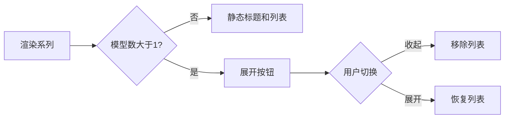
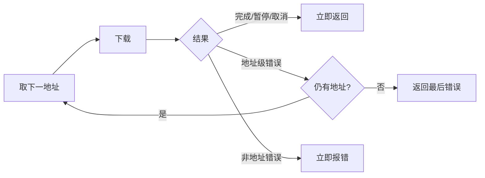
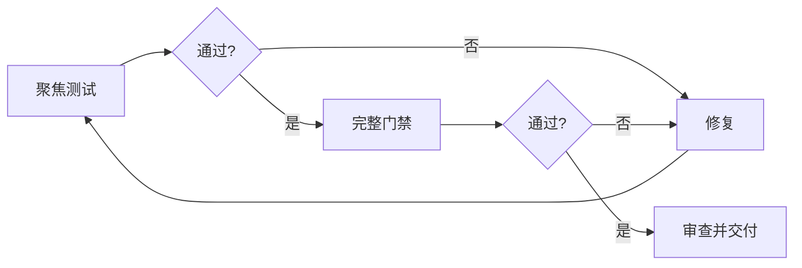

# 执行计划

## 总览

先以回归测试固定折叠交互和地址回退，再做局部实现，最后运行前后端完整门禁和差异审查。

## 任务 1：模型分组折叠

- 目标：多模型组默认展开并可双向切换；单模型组保持静态。
- 范围：`ModelManager.vue`、组件测试、局部 CSS。
- 测试：断言按钮数量、ARIA、折叠后列表消失、再次点击恢复。
- 风险：按钮嵌套或布局漂移；通过原生按钮、稳定尺寸和现有变量控制。

## 任务 2：候选地址顺序回退

- 目标：地址级失败尝试下一候选，所有候选失败后才返回错误。
- 范围：`HttpByteDownloader::download` 及其单元测试。
- 测试：404 后备用成功；多个地址均失败时请求数等于候选数。
- 风险：误吞本地错误；重试集合显式限制为 E004/E005/E006/E009。

## 任务 3：验证与审查

- 运行聚焦测试后执行前端完整测试、类型检查、构建及 Rust 测试、格式、Clippy。
- 审查差异只包含授权范围，不覆盖工作区已有变更。
- 若验证失败且属于本规格，回到实现修复，最多三轮无进展后记录阻塞。

## 模式决策

使用直接代码和现有循环：状态只在单组件内消费，错误策略只在单下载边界消费；新增抽象会增加跳转成本而无复用收益。
