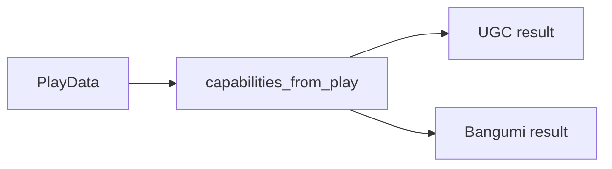
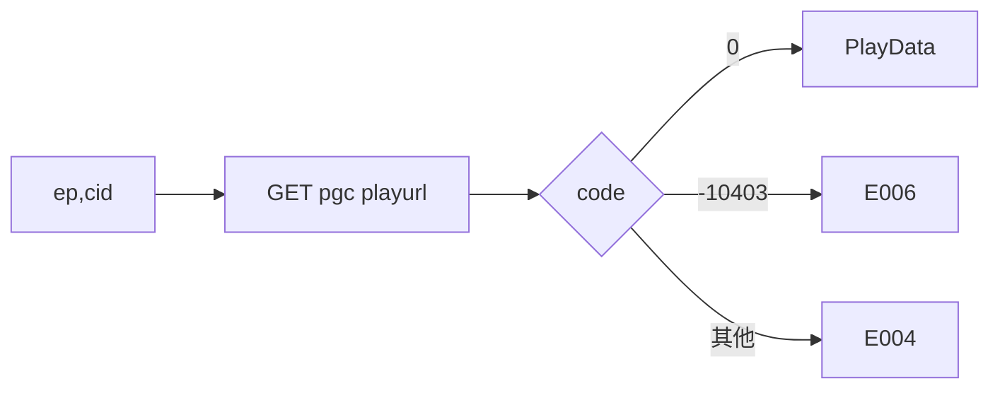
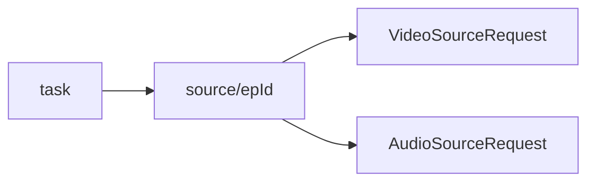
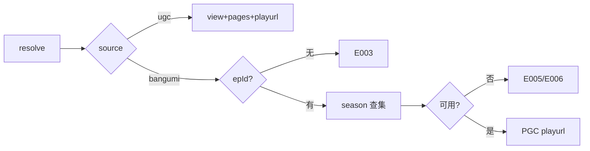
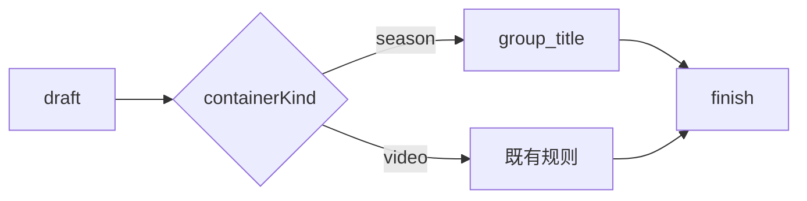
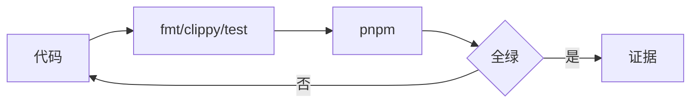

# 执行计划：取流与权限（episode-download）

## 摘要

6 个任务：能力映射抽取、PGC 端口、请求字段、解析权限与能力、命名、前端字段。交付后番剧可下载（免费/限免），受限集在取流前失败。

## 任务 T1：能力映射抽取

- 文件：`adapter.rs`。
- 步骤：把 `adapt_parse_result` 内 capabilities 计算抽成 `PlayCapabilities` + `capabilities_from_play`；`adapt_parse_result` 调用之；`adapt_bangumi_result` 接受 `Option<PlayData>` 并复用。
- 验证：既有 adapter 断言不变；番剧能力用例。
- 锚定：code-fact-backed；delta: none。

## 任务 T2：PGC 取流端口

- 文件：`client.rs`、`mod.rs`、`parser.rs` 测试 MockPort。
- 步骤：trait 加 `fetch_bangumi_playurl(ep_id, cid, auth)`；URL `pgc/player/web/playurl?ep_id&cid&fnval=4048&fourk=1&qn=127`；`PgcResponse<PlayData>`；非 0 → `map_api_error`。
- 验证：MockPort 实现；解析用例断言调用。
- delta: none。

## 任务 T3：请求与执行器字段

- 文件：`services/video/source.rs`、`services/video/executor.rs`、`services/video/track.rs`、`services/audio/source.rs`、`services/audio/executor.rs`。
- 步骤：两个请求结构加 `source: VideoSource`、`ep_id: Option<u64>`；4 处构造从 `spec.task` 填充。
- 验证：编译 + executor 既有测试。
- delta: none。

## 任务 T4：解析取流与权限

- 文件：`parser.rs`、`adapter.rs`（暴露 `bangumi_episode_availability`）。
- 步骤：
  1. `fetch_bangumi_play(ep_id, cid, auth)`：缺 epId→E003；season 查集→E004；可用性→E005/E006；成功后 PGC 取流。
  2. `AudioSourcePort::resolve` / `VideoSourcePort::resolve` 按 `source` 分支；UGC 路径不变。
  3. `parse` 的番剧分支：取代表集 playurl（失败降级 None）后 `adapt_bangumi_result`。
- 验证：会员集 E006、缺 epId 的 E003、集不匹配 E004、免费集成功。
- delta：权限提示语义（allowlist P5）。

## 任务 T5：命名与任务字段

- 文件：`models/task.rs`、`services/tasks/filename.rs`、`services/tasks/manager.rs`、前端 `contracts.ts`、`store.ts`。
- 步骤：`container_kind` 默认 video；`sanitize_season_filename`；manager 按 kind 选择命名；前端草稿带 `containerKind`。
- 验证：命名单测（season/video）、manager 用例、旧任务反序列化。
- delta：文件名规则（allowlist P6）。

## 任务 T6：回归与证据

- 命令：`cargo fmt --check`、`cargo clippy`、`cargo test`、`pnpm typecheck`、`pnpm test`、`pnpm build`。
- 输出 changelog/verification/review。

## 顺序与自愈

T1→T2→T3→T4→T5→T6；自愈 ≤7，同类 2 次升级、3 次阻塞。

## 风险

| 风险 | 回滚 |
| --- | --- |
| 端口签名改动扩散 | 只加字段不改方法 |
| 能力抽取改动行为 | 既有断言 + 新用例双保护 |
| 命名影响老文件 | 仅新任务生效 |
