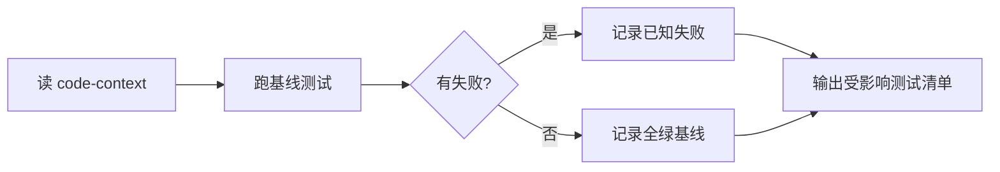
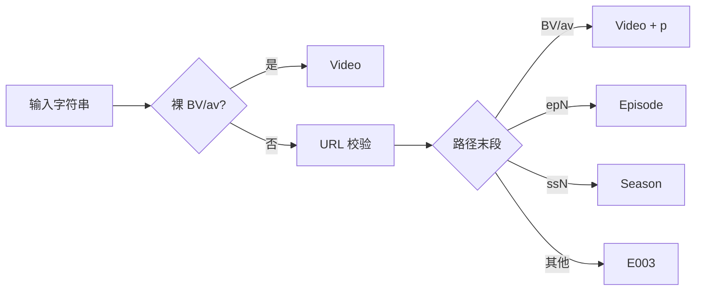
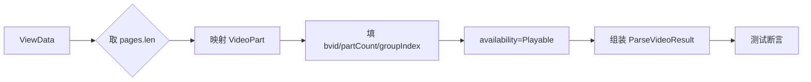
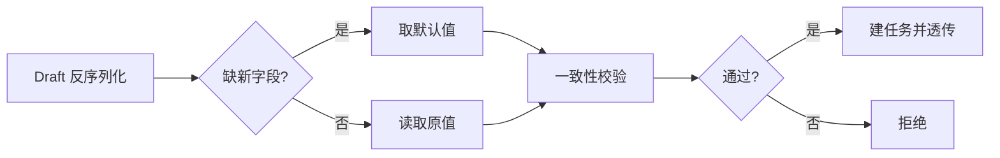
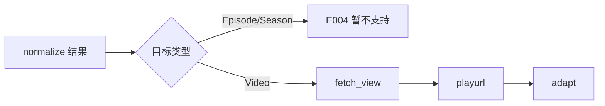
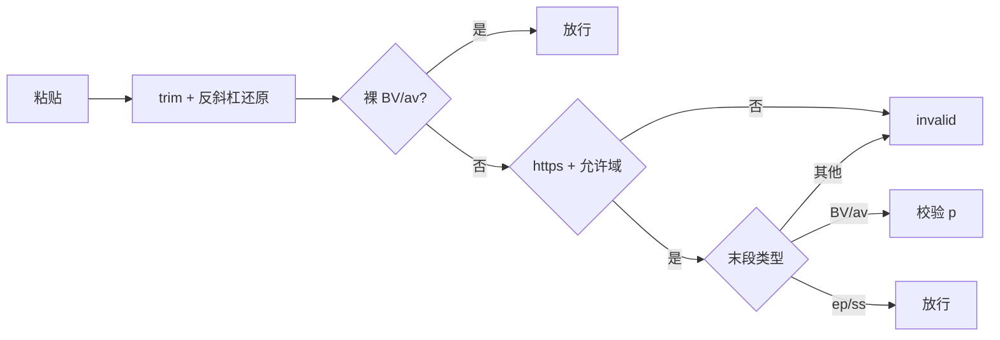
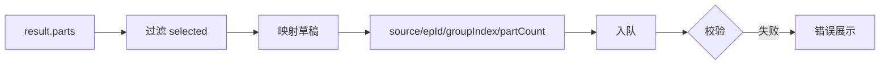
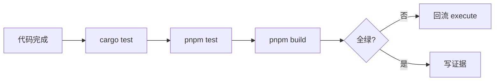

# 执行计划：输入与单元契约（episode-identity-and-contract）

## 摘要

模块 1 只做“识别 + 契约 + 兼容”，不做 B 站取数与 UI。共 8 个任务：1 个链路审查、5 个后端契约任务、2 个前端契约/适配任务，最后统一回归。交付后 `ep`/`ss` 链接不再被判 `E003`，单元与任务可携带集级标识，旧任务仍可读。

## 业务功能点与逻辑明细

| ID | 功能点 | 规则 | 失败/边界 | 验收 |
| --- | --- | --- | --- | --- |
| B1 | 识别番剧单集链接 | 路径最后一段匹配 `ep` + 正整数 | `ep0`/`epabc`/`ep` → `E003` | AC-1、AC-2 |
| B2 | 识别番剧季链接 | 路径最后一段匹配 `ss` + 正整数 | 同上 | AC-1、AC-2 |
| B3 | 稿件 `?p=` | 仅 `Video` 目标解析；正整数 | `0`/非数字 → `E003` | AC-1 |
| B4 | 单元字段语义 | `page`=容器内序号，`partCount`=容器内数量，`groupIndex`=容器序号 | `page > partCount` 拒绝 | AC-3、AC-9 |
| B5 | 可用性 | `playable` / `unavailable` + 原因 | unavailable 无原因 → 视为契约违规 | AC-4 |
| B6 | 剧集目标占位 | `Episode`/`Season` → `E004`，消息可区分 | 不得返回 `E003`，不得返回空成功 | AC-2 |
| B7 | 任务字段 | `source`/`epId`/`groupIndex`/`partCount` 带默认值 | 旧 JSON 缺字段可读 | AC-5 |
| B8 | 草稿一致性 | `bangumi` 必须有 `epId`；`ugc` 必须无 | 违反 → 校验失败 | AC-6 |

### 字段语义

| 字段 | 语义 | 空值 | 默认 |
| --- | --- | --- | --- |
| `source` | 任务/结果来源 | 不允许 | `ugc` |
| `epId` | 番剧单集 id | `null` 表示非番剧 | `null` |
| `groupIndex` | 容器在结果中的 1 起序号 | 不允许 | `1` |
| `partCount` | 容器内可下载 P 数 | 不允许 | `1` |
| `availability` | 单元可下载性 | 不允许 | — |
| `unavailableReason` | 不可下载原因 | `playable` 时必须 `null` | `null` |

## 任务 T1：变更链路审查与基线

- 目标：确认 `VideoId → parse_video → ParseVideoResult → store → draft → validation → manager → filename` 链路的真实调用方与测试面，记录基线。
- 范围：只读代码 + 跑一次基线测试，不改文件（`artifacts/code-context.md` 已产出，本任务复核并补漏）。
- 步骤：
  1. 复核 `code-context.md` 中 6 个符号的构造点/消费点。
  2. 记录基线：`cargo test`、`pnpm test` 当前结果（允许既有失败，需记录）。
  3. 列出将被新字段影响的测试文件清单。
- 验证：清单与 `code-context.md` 一致；基线输出写入 `execution/changelog.md`。
- 回退：无（只读）。
- source：code-fact-backed；product-content delta: none。

## 任务 T2：Rust 输入识别扩展

- 目标：`VideoId` 新增 `Episode(u64)`、`Season(u64)`；`normalize_input` 识别 `ep`/`ss` 路径段；`?p=` 仅对 `Bvid`/`Aid` 生效。
- 文件/符号：`src-tauri/src/infrastructure/bilibili/input.rs`（`VideoId`、`parse_video_id` → 拆分出 `parse_input_target`、`normalize_input`）。
- 前置：T1。
- 步骤：
  1. 枚举加两个变体；`parse_video_id` 保留 BV/av（裸输入），新增 URL 段解析函数处理 `ep`/`ss`。
  2. `normalize_pasted_url` 与空白校验不变。
  3. `?p=` 解析仅在目标为稿件时执行；`ep`/`ss` 忽略。
  4. 单测：矩阵 12 行（含 `ep0`、`ssabc`、`ep` 无数字、`?p=0`）。
- 状态：`Episode`/`Season` 归一成功即返回；未接入取数由 T5 处理。
- 风险：裸 `ep733316` 若被接受会超出 spec 矩阵 → 只允许 URL 形态。
- 验证：`cargo test input`。
- source：source-backed（S1/S3）+ confirmed-decision（Q9/Q2）；product-content delta：新增两类输入判定（allowlist P1）。

## 任务 T3：解析 DTO 与 UGC 适配填充

- 目标：`ParseVideoResult` 增加 `source`、`container`，`bvid`/`aid` 改为可空；`VideoPart` 增加 `bvid`、`epId`、`partCount`、`groupIndex`、`availability`、`unavailableReason`；`adapter` 在 UGC 路径填充等价值。
- 文件/符号：`src-tauri/src/models/parse.rs`（新增枚举与结构）、`src-tauri/src/infrastructure/bilibili/adapter.rs`（`adapt_parse_result`、`select_part` 不变）。
- 前置：T2。
- 步骤：
  1. 定义 `VideoSource`、`ContainerKind`、`ParseContainer`、`Availability`、`UnavailableReason`（serde camelCase / kebab-case）。
  2. `VideoPart` 新字段；`ParseVideoResult.bvid/aid` 改 `Option`。
  3. `adapter`：先取 `pages.len()`，再映射；`bvid = view.bvid`、`epId = None`、`partCount = pages.len()`、`groupIndex = 1`、`availability = Playable`、`unavailableReason = None`；`source = Ugc`；`container = Some(video …)`。
  4. 更新 fixture 测试断言（数量 + 新字段值）。
- 状态：无状态。
- 风险：`view.pages` 被 move 前需先算 len；遗漏会编译失败（好事）。
- 验证：`cargo test adapter`。
- source：source-derived（X1）+ confirmed-decision（H4）+ code-fact-backed；product-content delta：新增单元字段（allowlist P4/P8）。

## 任务 T4：任务契约与校验

- 目标：草稿与任务增加 `source`、`epId`、`groupIndex`、`partCount`；旧 JSON 可读；草稿一致性校验。
- 文件/符号：`src-tauri/src/models/task.rs`、`src-tauri/src/services/tasks/manager.rs`（`create`）、`src-tauri/src/services/tasks/validation.rs`（`validate_create_request`）。
- 前置：T3。
- 步骤：
  1. 结构体加字段；`#[serde(default)]`；`default_source()`、`default_group_index()`、`default_part_count()`。
  2. `manager.create` 透传新字段（任务记录 + 事件）。
  3. `validation` 增加：`bangumi` 必须有 `epId`；`ugc` 必须无；`epId>0`。
  4. 单测：旧 JSON（无新字段）反序列化；非法组合被拒。
- 风险：`DownloadTask` 若被持久化层序列化两次，需要确认只有 serde。
- 验证：`cargo test tasks`。
- source：code-fact-backed + confirmed-decision（H3/H4）；product-content delta：任务字段（allowlist P4/P6 的承载，不改命名）。

## 任务 T5：剧集目标占位分支

- 目标：`ParserService::parse` 对 `Episode`/`Season` 返回 `E004`（暂不支持该内容类型），不进入 `fetch_view`。
- 文件/符号：`src-tauri/src/services/parser.rs`（`parse`）。
- 前置：T2。
- 步骤：
  1. `normalized.video_id` 匹配 `Episode|Season` → `AppError::new(E004, "..temporarily unavailable..")`。
  2. 其余路径完全不变。
  3. 单测：`ep`/`ss` 输入断言 `E004`；`BV` 输入仍走正常路径（用既有 mock）。
- 清理触发：模块 2 合入时删除该分支（写入 changelog 的 cleanup 清单）。
- 风险：消息若与“输入无效”相同会误导 → 文案必须点明“暂不支持该内容类型”。
- 验证：`cargo test parser`。
- source：confirmed-decision（ADR-6）；product-content delta：新增一条错误提示语义（用户可见，allowlist P5 的未来复用；本模块仅提示“暂不支持”）。

## 任务 T6：前端契约与输入校验

- 目标：TS 契约镜像新字段；`input.ts` 接受 `ep`/`ss` 链接，裸 `ep` 仍拒绝。
- 文件/符号：`src/features/download-center/contracts.ts`、`src/features/download-center/input.ts`（`isSupportedUrl`）。
- 前置：T2（规则对齐）。
- 步骤：
  1. `contracts.ts`：新增 `VideoSource`、`ContainerKind`、`ParseContainer`、`Availability`、`UnavailableReason`；`VideoPart` 新字段；`ParseVideoResult.bvid/aid` 改 `string | null` / `number | null`，加 `source`、`container`；`DownloadTaskDraft` 加 `source`/`epId`/`groupIndex`/`partCount`。
  2. `input.ts`：末段匹配 `BV…|av…|ep…|ss…`；`ep`/`ss` 不解析 `p`；其余规则不变。
  3. 测试：与 Rust 同批矩阵；`ep0`、`ssabc` 拒绝。
- 风险：`normalizeParseInput` 返回值不变，store 不需改判定。
- 验证：`pnpm test input`、`pnpm build`。
- source：source-backed（S1）+ code-fact-backed；product-content delta：输入判定（allowlist P1）。

## 任务 T7：草稿构造与测试夹具适配

- 目标：`buildDrafts` 使用单元字段；所有因新字段而失败的测试/夹具同步。
- 文件/符号：`src/features/download-center/store.ts`（`buildDrafts`）、前端测试与 demo 夹具、`src/features/task-management/contracts.ts`（若共享类型需要）。
- 前置：T6。
- 步骤：
  1. `buildDrafts` 输出 `source: result.source`、`epId: part.epId`、`groupIndex: part.groupIndex`、`partCount: part.partCount`。
  2. 逐个修复测试对象字面量（`DownloadPage.test`、`store.test`、`service.test`、`task-drafts.test`、`TaskRow.test`、demo 服务）。
  3. 断言：多单元草稿的 `bvid`/`page` 来自各自单元，不共享顶层 bvid。
- 风险：夹具数量多，易出现“只补字段不补断言” → 要求至少一条串号断言。
- 验证：`pnpm test`。
- source：confirmed-decision（H4）+ code-fact-backed；product-content delta: none（仅字段搬运）。

## 任务 T8：回归、清理与证据

- 目标：全量验证、清理临时物、写 changelog 与 verification。
- 步骤：
  1. `cargo test`（含 `cargo fmt --check` 若可用）。
  2. `pnpm test`、`pnpm build`。
  3. 检查无 debug 输出、无未用导入、无过期注释；确认临时分支已登记 cleanup。
  4. 写 `execution/changelog.md`、`verification/verification.md`（证据：命令 + 结果 + AC 映射）。
- 验证：三个命令通过或记录原因。
- source：code-fact-backed；product-content delta: none。

## 依赖与执行顺序

严格串行：T1 → T2 → T3 → T4 → T5 → T6 → T7 → T8。T5 可与 T3/T4 并行（不同文件），但为避免编译期互相阻塞，仍按序执行。

## 验证策略

| AC | 验证方式 |
| --- | --- |
| AC-1 | `input.rs` / `input.ts` 矩阵单测 |
| AC-2 | `parser.rs` 单测断言 `E004` |
| AC-3 | `adapter.rs` 单测断言 `page/partCount/cid` |
| AC-4 | `adapter`/模型单测断言原因与状态配对 |
| AC-5 | `models/task.rs` 旧 JSON 反序列化测试 |
| AC-6 | `validation.rs` 组合测试 |
| AC-7 | 既有测试全量回归 |
| AC-8 | `cargo test`、`pnpm test`、`pnpm build` |
| AC-9 | `adapter` 断言 + 前端串号断言 |

## 自愈闭环计划

- 循环：`execute → verify → review → 回流 execute`，最多 7 次迭代；同一 blocker 连续 2 次失败升级到 plan/spec，累计 3 次阻塞。
- 缺陷分类：需求不一致 → spec；计划缺口 → plan；类型/逻辑/运行时 → execute；结构问题 → architecture-design。
- 无进展（无新证据、无修复、无更窄诊断）立即阻塞。
- 完成条件：AC-1…AC-9 全通过，证据齐全，cleanup 清单登记。

## code-review checklist 合同

- 健壮性：URL 解析不 panic；`Option` 解包用显式分支；非法输入返回错误。
- 可维护性：单函数 < 150 行；`match` 穷尽；新枚举有语义注释。
- 性能与内存：无新增缓存/订阅；解析为一次性纯函数。
- 规范一致性：沿用 camelCase 序列化、`AppError` 构造、测试命名。

## 风险与回滚

| 风险 | 回滚 |
| --- | --- |
| DTO 字段扩散导致大面积测试失败 | 保留新字段但先用默认值填充，测试逐批修复 |
| 前端类型遗漏 | `pnpm build` 阻断，不允许 `any` 绕过 |
| 临时 E004 被误解为永久方案 | changelog 明确 cleanup trigger |

## execute-readiness 自检

- 文件/符号：全部指定到具体路径与函数。
- 数据合同：字段、类型、默认值、不变式齐全。
- 业务规则：8 条功能点 + 边界表。
- 验证命令：明确。
- 未决产品问题：无（Q5–Q9 已定默认，模块 3/4 使用）。
- 技术栈：不新增依赖、不改目录结构。
