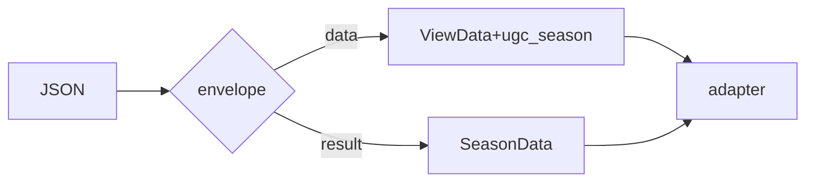
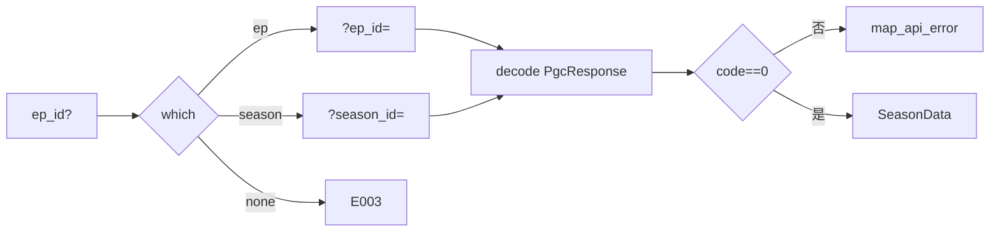
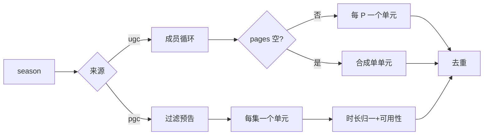
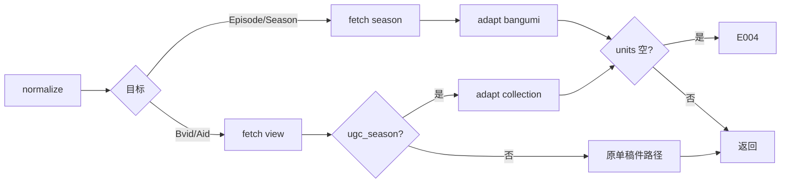
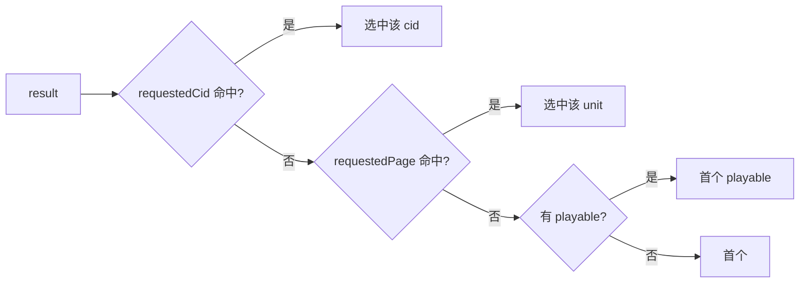
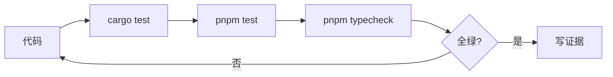

# 执行计划：合集/番剧元数据解析（episode-metadata）

## 摘要

6 个任务，全部落在既有文件：扩 raw 模型、加一个 PGC 端口、写两个纯函数适配、改 `parse` 为三路分派、前端加默认选中优先级、补测试。交付后合集与番剧能返回完整单元列表（番剧暂无可下载能力，由模块 3 补齐）。

## 业务功能点

| ID | 功能 | 规则 | 边界 |
| --- | --- | --- | --- |
| B1 | 合集展开 | `ugc_season.sections[].episodes[]` → 单元；成员内 `pages[]` 逐个 P | 无 season → 原单稿件路径 |
| B2 | 番剧展开 | `pgc season.episodes[]` → 单元；`section_type≠0` 过滤 | 全为预告 → `E004` |
| B3 | 时长归一 | PGC `(ms+500)/1000`；UGC 秒 | 缺失 → 0 |
| B4 | 可用性初判 | `allow_download=0`→download-disabled；badge 会员→vip；付费→paid；其余 playable | 未知 badge → playable（模块 3 复核） |
| B5 | 默认选中 | `requestedCid` > `requestedPage` > 首个 playable | ep 不在列表 → null |
| B6 | 容错 | 坏条目跳过；空结果 `E004` | 不补位 |

## 任务 T1：raw 模型与 PGC envelope

- 目标：能反序列化 `ugc_season` 与 PGC season。
- 文件：`src-tauri/src/infrastructure/bilibili/raw.rs`。
- 步骤：新增 `PgcResponse<T>`、`SeasonData`、`RawEpisode`、`RawEpisodeRights`、`RawUgcSeason`、`RawSeasonSection`、`RawSeasonEpisode`；`ViewData` 加 `ugc_season: Option<RawUgcSeason>`；字段全部 `#[serde(default)]`。
- 验证：单测反序列化最小 PGC JSON 与合集 JSON。
- 锚定：source-derived（X1–X3）；product-content delta: none（内部模型）。

## 任务 T2：PGC 端口方法

- 目标：`ep_id`/`season_id` 二选一请求 season。
- 文件：`client.rs`、`mod.rs`（trait 与导出）。
- 步骤：trait 加 `fetch_bangumi_season(&self, ep_id: Option<u64>, season_id: Option<u64>, auth) -> Result<SeasonData, AppError>`；实现构造 URL（`?ep_id=` / `?season_id=`）；非 0 码走 `map_api_error`；两者都为空返回 `E003`。
- 验证：单测断言 URL 参数与错误码；mock 端口实现需补方法（`parser.rs` 测试 MockPort）。
- 锚定：source-derived；product-content delta: none。

## 任务 T3：两个适配函数

- 目标：把两种来源转成 `VideoPart` 列表。
- 文件：`adapter.rs`。
- 步骤：
  1. `duration_ms_to_seconds(ms)` 私有函数。
  2. `adapt_collection_units(season, entry_bvid) -> Vec<VideoPart>`：按成员顺序，`groupIndex` 递增；成员 `pages` 非空逐个 P，否则合成单单元；`bvid`=成员；`epId=None`；`partCount`=P 数；`availability=Playable`。
  3. `adapt_bangumi_units(season) -> Vec<VideoPart>`：过滤 `section_type!=0`；`epId`/`bvid`/`cid`；`title` 优先 `long_title`；时长归一；可用性初判；`page=1`、`partCount=1`、`groupIndex` 递增。
  4. 重名 `cid` 去重。
- 验证：三条单测（多 P 成员、单 P 成员、番剧含预告与三态可用性）。
- 锚定：confirmed-decision（H1/H4/Q6）+ source-derived（X1–X3）；product-content delta：单元可用性初判（allowlist P5 的前置）。

## 任务 T4：解析分派与 requestedCid

- 目标：`parse` 支持三条路径并删除模块 1 占位分支。
- 文件：`parser.rs`、`models/parse.rs`。
- 步骤：
  1. `ParseVideoResult` 加 `requested_cid: Option<u64>`。
  2. `parse`：`Bvid/Aid` → `fetch_view`；若 `ugc_season` 非空 → `adapt_collection_result`（复用入口 playurl 能力）；否则原路径。
  3. `Episode/Season` → `fetch_bangumi_season` → `adapt_bangumi_result`（能力为空）；`requestedCid` = ep 对应首单元 cid。
  4. 删除 `E004` 占位分支。
  5. 空单元列表 → `E004`。
- 锚定：source-derived + confirmed-decision（模块边界）；product-content delta：`requestedCid`（allowlist 默认选中）。

## 任务 T5：前端契约与默认选中

- 目标：`requestedCid` 进入契约；默认选中优先级。
- 文件：`contracts.ts`、`store.ts`。
- 步骤：接口加 `requestedCid: number | null`；`applyResult` 选中顺序改为 cid 命中 → page 命中 → 首个 `availability==="playable"` → 首个。
- 验证：store 测试（ep 场景选中指定 cid；ss 场景首个；无 playable 时回退首个）。
- 锚定：source-derived（S3）；product-content delta：默认选中规则。

## 任务 T6：测试夹具与回归

- 目标：补 fixture 与断言，跑全量。
- 步骤：新增 PGC season fixture、合集 view fixture；parser 三路径测试；前端夹具补 `requestedCid`；跑 `cargo test`、`pnpm test`、`pnpm typecheck`。
- 锚定：code-fact-backed；product-content delta: none。

## 依赖与顺序

T1 → T2 → T3 → T4 → T5 → T6（严格串行；T5 可在 T4 后并行）。

## 验证策略

AC-1/2 由 T3 单测覆盖；AC-3/4/5 由 T3 单测；AC-6 由 T4 + 前端 store 测试；AC-7 由 T4 单测；AC-8 由删除分支与全量回归证明；AC-9 由命令证据。

## 自愈闭环

execute → verify → review，≤7 次迭代；同类 blocker 2 次升级、3 次阻塞；无进展即阻塞。

## code-review checklist 合同

健壮性：所有 PGC 字段可缺省；空集/坏条目显式处理。可维护性：两个 adapter 对称、时长函数单点。性能：不逐成员请求。规范：沿用 `AppError`、serde 命名、测试命名。

## 风险与回滚

| 风险 | 回滚 |
| --- | --- |
| PGC 字段与实测不符 | fixture 驱动修正，不猜字段 |
| 删除占位分支后番剧链路报错 | 三条路径测试先行（T4 内红绿） |
| 前端默认选中回归 | 保留 page 回退用例 |

## execute-readiness 自检

文件/符号、字段、单位、过滤、可用性、默认选中、验证命令均已指定；无未决产品问题（Q1–Q8 已定）。
