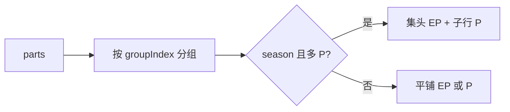
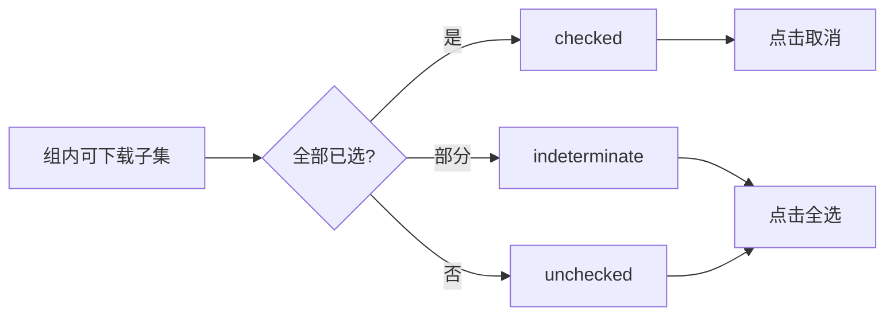
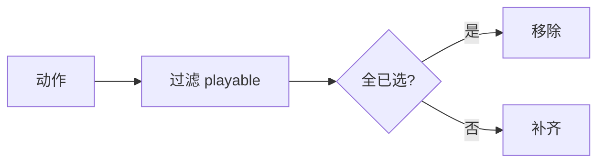
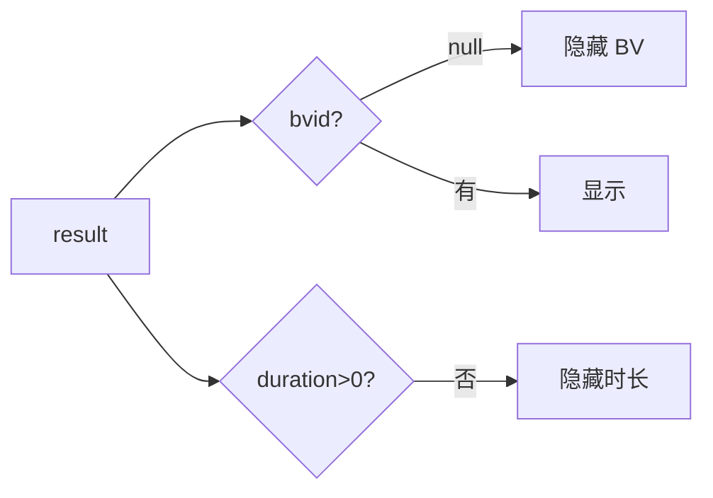
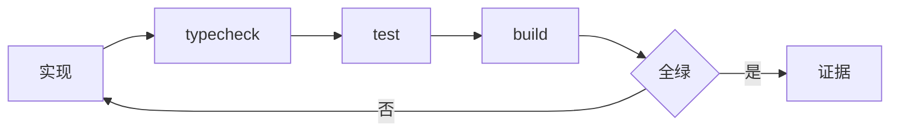

# 执行计划：统一选集界面（episode-selection-ui）

> 说明：本模块在实现前以会话内任务分解推进，随后补写本计划以保证仓库可追溯；任务与验证结果一致，偏差已在 `execution/changelog.md` 与 `review/review.md` 记录。

## 摘要

5 个任务：视图模型、集头渲染与半选、选择动作、摘要与文案样式、测试。全部落在既有文件，另新增 `format.ts`（时长格式化，2 个真实调用方）。

## 任务 T1：视图模型与标签

- 文件：`components/PartSelector.vue`。
- 规则：按 `groupIndex` 分组；`container.kind=season` 且组内 >1 单元 → 集头 `EP{n}` + 子行 `P{page}`；否则平铺，season 用 `EP{groupIndex}`、video 用 `P{page}`。
- 验证：组件测试标签断言。
- 锚定：H2/H4；delta：标签体系（allowlist P3/P8）。

## 任务 T2：集头与半选

- 文件：`PartSelector.vue`、`download-center.css`。
- 规则：集头复选框 checked=全部可下载子单元选中；indeterminate=部分；无可下载子单元时 disabled；点击 emit `toggleGroup(selectable cids)`。
- 验证：半选/联动用例。

## 任务 T3：选择动作

- 文件：`store.ts`。
- 规则：`togglePart` 忽略不可下载；`toggleGroup` 只作用于可下载、全选/反选只含可下载；保持不可变更新。
- 验证：store 用例（select-all/invert/group/toggle 跳过不可下载）。

## 任务 T4：摘要、文案与样式

- 文件：`VideoSummary.vue`、`locales/{zh-CN,en-US}.ts`、`download-center.css`、`format.ts`。
- 规则：隐藏空 `bvid`、0 时长；新增 `download.unavailableReasons.*`；集头/子行/禁用/原因/时长样式；`formatDuration` 由 `format.ts` 统一（2 个调用方）。
- 验证：typecheck + 组件渲染。

## 任务 T5：测试与回归

- 文件：`PartSelector.test.ts`（新增）、`store.test.ts`。
- 命令：`pnpm typecheck`、`pnpm test`、`pnpm build`。
- 验证：58 files / 242 tests；build 通过。

## 顺序与自愈

T1→T2→T3→T4→T5；自愈 ≤7，同类 2 次升级、3 次阻塞。

## 风险

| 风险 | 回滚 |
| --- | --- |
| 既有测试按平铺断言 | 已核对，全部通过 |
| 半选属性兼容 | 使用 DOM property + 显式 checked |
| 新增文案键遗漏英文 | 双语同时新增 |
