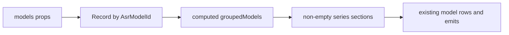

# 实施计划：模型系列分组

## 范围合同

- 仅修改 `ModelManager` 及其测试、局部样式和中英文文案。
- 不修改 `AsrModel` IPC 合同、store、后端清单和下载行为。
- 无阻塞项或产品假设。

## 数据与流程

- 输入：只读 `AsrModel[]` props。
- 派生：按固定系列顺序过滤模型，组内不排序。
- 输出：`{ id, labelKey, models }[]`，仅包含非空组。
- 副作用：无；已有按钮继续 emit 原始模型 ID。

## 任务

1. **RED - 分组行为测试**
   - 文件：`src/features/transcription/components/ModelManager.test.ts`
   - 新增 FireRedASR2 测试模型，以交错 props 顺序渲染弹窗。
   - 断言两个 `section` 标题、Whisper 组成员、FireRedASR2 组成员、组内顺序和空组不显示。
   - 运行 `npm test -- src/features/transcription/components/ModelManager.test.ts`，确认因缺少分组而失败。
2. **GREEN - 局部类型映射与渲染**
   - 文件：`src/features/transcription/components/ModelManager.vue`
   - 将 `defineProps` 绑定为 `props`，定义 `ModelSeries`、系列顺序和 `Record<AsrModelId, ModelSeries>`。
   - 新增 `computed groupedModels`，模板外层按组渲染 `section` 和标题，内层保留现有模型行。
   - 添加 `aria-labelledby` 和稳定标题 ID。
3. **GREEN - 本地化与样式**
   - 文件：`src/locales/zh-CN.ts`、`src/locales/en-US.ts`、`src/features/transcription/transcription.css`
   - 在 `transcribe.models.series` 增加 `whisper` 和 `fireRedAsr2` 文案。
   - 使用现有颜色令牌增加紧凑分组间距和标题样式，不嵌套卡片。
4. **REFACTOR 和链路检查**
   - 确认 `download/cancel/delete/close` 的 emit 与参数未变。
   - 搜索新 class、label key 和系列类型，确认无孤立引用、无未使用 import。
5. **验证**
   - `npm test -- src/features/transcription/components/ModelManager.test.ts`
   - `npm test`
   - `npm run typecheck`
   - `npm run build`
   - 打开开发应用的模型管理弹窗，以桌面与窄视口检查分组层级、溢出和重叠。

## 代码评审合同

- Robustness：映射必须穷尽 `AsrModelId`，空数组不报错。
- Maintainability：分组逻辑保持在 owning component，不新增单用途 helper 文件或字符串名称猜测。
- Performance/memory：模型数量小，一次线性 computed 足够；无监听器、订阅或清理责任。
- Stack anchoring：继续使用 Vue 3 Composition API、Naive UI、Vue I18n、Vitest 和现有 CSS 令牌。
- UI fidelity：系列归属不依赖颜色，文本标题在默认状态可见。
- Diff hygiene：不修改相邻 store、合同或后端，不包含 debug 代码和无关格式化。

