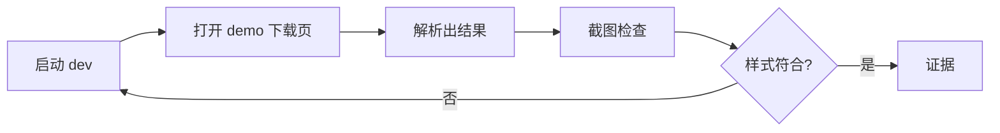

# 执行计划：自动转写开关行视觉优化

## 摘要

纯样式改动，2 个任务：补 CSS、视觉与回归验证。行为、文案、结构不动。

## 任务 T1：补充开关行样式

- 文件：`src/features/download-center/download-center.css`。
- 内容：按 spec 的视觉合同新增 `.download-transcription-option`、`.download-transcription-option span/strong/small`、`.switch-control` 及 `:checked` / `:focus-visible` / hover 规则。
- 不改 `DownloadOptions.vue` 结构。
- 验证：`pnpm typecheck`、`pnpm test`、`pnpm build`。

## 任务 T2：视觉复核与回归

- 用 dev demo 模式（`#demo=1`）渲染解析结果，截图对比改动前后。
- 检查深色主题变量生效、窄宽度不溢出。
- 验证：截图 + 全量前端检查。

## 风险与回滚

- 只改 CSS，回滚即删除新增规则块。
- 若开关语义受 `appearance:none` 影响键盘操作，保留原生 checkbox 焦点行为并验证 Space 切换。
