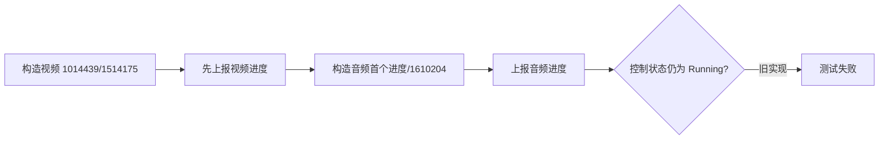

# 计划：双轨下载进度单调化

## 模块标识与范围

`bilicatch-video-progress-auto-cancel-20261002`，仅覆盖共享下载百分比规则、视频双轨行为测试和 Rust 验证。

## 阅读导航

按 `T1 -> T2 -> T3` 串行执行。T1 必须先在旧实现上产生预期失败；T2 只写使测试通过的最小实现；T3 执行完整门禁并形成可审计证据。

## 全局摘要

通过 TDD 修复总量扩展造成的百分比回退。任务管理器、IPC、持久化与用户取消语义保持不变。

## 任务拆解

### T1：建立失败回归测试

- 目标：用真实复现字节数证明 `download_percent` 会从 60 回退，并证明视频后音频首次上报会触发真实下载控制器取消。
- 关联规格：AC-1、AC-3、AC-4。
- 影响面：`audio_download_contract.rs` 或等价计算测试；`video/progress.rs` 行为测试。
- 执行模式：串行，第一步。
- 前置条件：spec 已批准。
- 完成条件：测试可编译且在未修改生产代码时因百分比回退/控制器变为 `CancelRequested` 而失败。
- 禁止猜测：测试数值必须来自已确认任务记录和官方流大小；不使用随机时序。



### T2：实现最小单调钳制

- 目标：让有效总量分支返回 `max(raw_percent, current.min(90))`。
- 关联规格：function-complete 行为、设计约束、AC-1 至 AC-4。
- 影响面：`src-tauri/src/services/download/transfer.rs`。
- 执行模式：串行，依赖 T1 红灯。
- 前置条件：T1 已按预期失败。
- 完成条件：T1 定向测试全部通过；既有百分比边界测试不变。
- 禁止猜测：不修改 reporter、任务管理器、状态机或取消分支，不增加新抽象。

```mermaid
flowchart LR
  A[计算 raw_percent] --> B[钳制到 90]
  B --> C[与 current.min(90) 取最大值]
  C --> D[返回单调百分比]
```

### T3：验证、回归与交付证据

- 目标：确认修复没有破坏下载、任务或其他 Rust 行为，并完成格式、验证与评审记录。
- 关联规格：AC-2、AC-5、安全与回滚约束。
- 影响面：Rust 定向测试、完整测试、格式检查、请求工件。
- 执行模式：串行，依赖 T2 绿灯。
- 前置条件：最小实现已通过定向测试。
- 完成条件：`cargo fmt --check`、定向测试和完整 `cargo test` 通过，验证与评审无阻断项。
- 禁止猜测：任何失败先按根因处理，不通过跳过测试或降低断言完成交付。


## 功能拆解明细

- 入站接口：无变化。
- 业务服务/领域流程：下载百分比保持单调。
- 持久化与迁移：无变化、无迁移。
- MySQL / Redis / Kafka / gRPC / Kubernetes：不适用。
- 异步任务与事件流：`ProgressSink -> ExecutionReporterPort -> TaskManager` 顺序不变。
- 兼容性与回滚：函数签名和事件结构不变，可直接恢复原表达式回滚。
- rollout / gray release：随下一桌面版本发布，无混合版本数据风险。
- 观测性：现有任务进度与状态足以验证，不新增日志或指标。
- 安全验证：鉴权、secret、敏感数据和滥用面均不适用；确认测试不写入签名 URL。
- 测试切面：纯函数边界测试 + 双轨控制器行为测试 + 完整 Rust 回归。

## 接口契约与兼容性策略

所有公共与内部接口签名保持不变；`ExecutionUpdate::Progress` 契约不变。兼容性风险仅限百分比不再回退，属于缺陷修正。

## 基础设施依赖策略

无新增依赖或运行时配置。

## 依赖关系

`T1 -> T2 -> T3`，不并行。

## 整洁性与复杂度控制

规则只保留在 `download_percent`；测试命名直接说明“总量扩展时不回退”和“合法双轨进度不取消”。不抽取一次性 helper 到生产代码。

## 模式决策与替代方案

采用直接纯函数修改。拒绝放宽任务管理器校验，因为会让真正的乱序或回退快照进入持久化；拒绝在视频进度模块复制钳制逻辑，因为共享函数已拥有 `current` 参数。

## 代码上下文与影响范围

详见 `artifacts/code-context.md`。生产改动预计限于一个表达式，测试改动限于 Rust 进度相关测试。

## 并行执行建议

不建议并行；TDD 红绿顺序是硬依赖，任务规模不足以支持并行收益。

## 触发与上下文准备

使用任务记录中的 `1014439 / 1514175, current=60` 和官方音频总长 `1610204` 作为确定性测试数据。

## 受影响文件或模块

- `src-tauri/src/services/download/transfer.rs`
- `src-tauri/tests/audio_download_contract.rs`
- `src-tauri/src/services/video/progress.rs` 或等价视频进度测试位置
- 本请求 verification/review 工件

## 测试策略

- RED：先运行新增定向测试并确认旧实现失败原因是百分比回退和自动取消。
- GREEN：实现最小钳制后重复定向测试。
- 回归：运行 `cargo test`。
- 格式：运行 `cargo fmt --check`。

## 发布与灰度计划

无独立灰度开关；修复不改变数据结构，可随常规桌面构建发布。

## 观察与人工介入点

若定向测试未在旧实现失败，停止实现并重新检查测试场景。若完整回归失败，回到 execute 修复根因。

## 回滚说明

恢复 `download_percent` 有总量分支的原表达式并移除本次新增测试即可代码回滚；无数据回滚动作。
