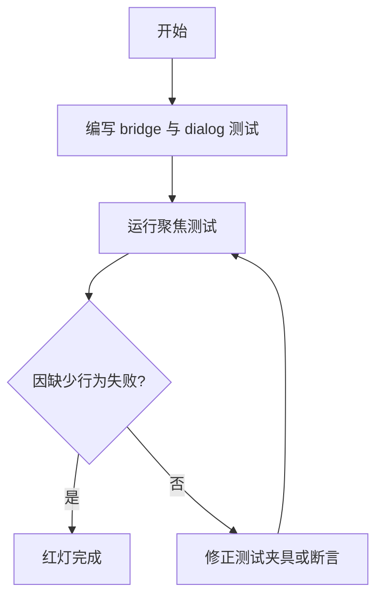
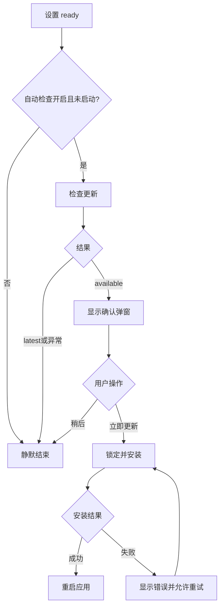
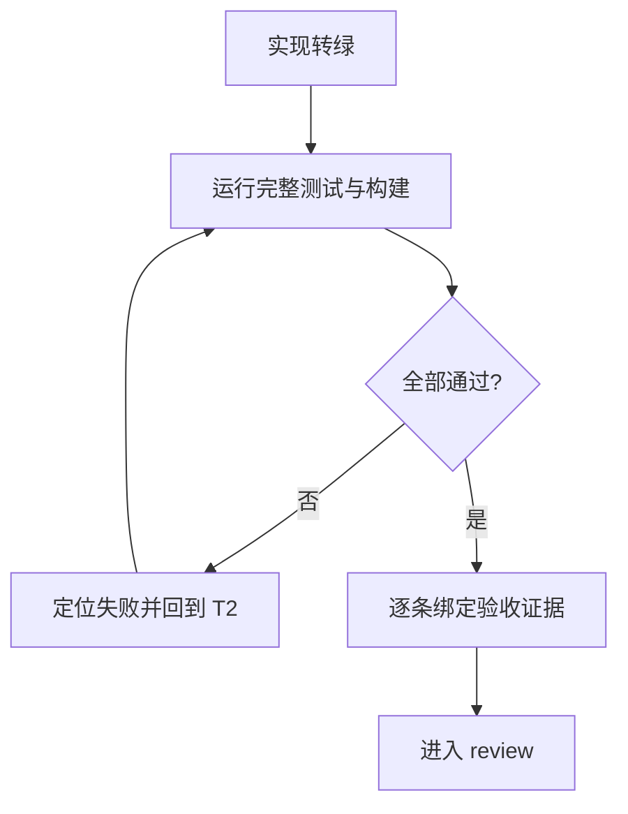

# 实施计划：启动更新确认流程

## 交付单元标识

`startup-update-flow`

## 阅读导航

- 目标：启动后按设置自动检查，发现新版时确认安装。
- 任务：3 个，全部串行。
- 高风险：重复触发、安装态可关闭、自动检查错误干扰启动。
- 关键依赖：设置 store ready、`ReleaseActionsPort`、Naive UI provider。

## 全局摘要

执行主线为 TDD 红灯、最小组件实现、完整回归。状态主线为 `idle -> checking -> available -> installing -> relaunch/error`，latest/error 静默。实施前置条件是已批准 spec、已读取 `tsconfig.json` 与本地 release 类型。

## T1：建立启动检查与弹窗红灯测试

### 任务目标

用失败测试证明当前代码缺少自动检查桥接与确认弹窗行为。

### 规格映射

AC-1 至 AC-7。

### 范围与影响面

- 新增 bridge 行为测试。
- 新增 dialog 组件测试。
- 使用真实 Pinia store、真实 Vue 组件；只替换外部 release port。

### 前置与完成条件

- 前置：spec 已批准，生产组件尚不存在。
- 完成：测试因缺少目标组件或行为而按预期失败，不得因配置或语法错误失败。

### 实现子项

- 构造 ready/disabled/loading/error 的设置快照。
- 验证 once、silent、available、install、retry。
- 验证 alertdialog、版本字段、默认焦点与 pending 关闭保护。

### 交互与状态约束

测试以用户可见 DOM 与 release side effect 为断言，不断言私有实现变量。

### API 与数据约束

mock `ReleaseActionsPort` 完整三个方法，返回手写字面量合同。

### 测试与验证要点

运行两个新测试文件，记录预期红灯。

### 风险与回退

若 NModal teleport 影响查询，测试 attachTo body；不修改生产组件规避测试。

## T2：实现启动协调与确认弹窗

### 任务目标

以最小代码使红灯测试通过，并符合页面设计。

### 规格映射

页面与模块设计、功能完整行为、AC-1 至 AC-7。

### 范围与影响面

- 新增 `StartupUpdateBridge.vue` 与 `UpdateConfirmDialog.vue`。
- `App.vue` 挂载 bridge。
- locale 增加双语更新弹窗文案。
- settings CSS 增加独立弹窗样式。

### 前置与完成条件

- 前置：T1 红灯已确认。
- 完成：聚焦测试转绿，无新增依赖和 API 变化。

### 实现子项

- watch 设置 ready + 开关，使用 started/disposed guard。
- available 时保存版本并打开 dialog。
- install 使用 pending guard，失败写本地化 error key。
- dialog 实现安全焦点、恢复焦点、Tab 循环与 pending 锁定。
- 复用 Lucide 图标、现有色彩 token 与按钮风格。

### 交互与状态约束

- latest/check error 不可见。
- dismiss 后本生命周期不重复提示。
- pending 期间不能 close。
- error 后 confirm 可重试。

### API 与数据约束

直接消费 `UpdateCheckResult`；不修改 `ReleaseActionsPort` 或 Tauri adapter。

### 测试与验证要点

运行聚焦测试并执行 typecheck；检查长文本、按钮尺寸和可访问角色。

### 风险与回退

若 bridge 过度复杂，优先提取局部纯函数，不新增 store 或通用状态机。回退只需移除根挂载和新增组件。

## T3：完整回归与交付证据

### 任务目标

验证新增流程及其邻接功能均满足规格并形成可审查证据。

### 规格映射

AC-8、风险与人工交接。

### 范围与影响面

- 全部前端测试。
- Vue/TypeScript 类型检查与生产构建。
- 差异检查和现有 Rust 改动隔离确认。

### 前置与完成条件

- 前置：T2 聚焦测试转绿。
- 完成：`npm test`、`npm run typecheck`、`npm run build`、`git diff --check` 全部成功。

### 实现子项

- 检查设置页与 App 现有测试。
- 记录 acceptance criteria 逐条证据。
- 对实现做 clean-code、pattern 与视觉约束审查。

### 交互与状态约束

确认自动流程不改变手动检查、托盘路由和设置保存行为。

### API 与数据约束

确认 `ReleaseActionsPort` 签名、Tauri updater adapter 和 IPC 均无变化。

### 测试与验证要点

失败则回到 T2 修复并重新执行全部门禁，不以局部通过替代完整证据。

### 风险与回退

真实 relaunch 无法在 Vitest 中验证，保留为发布冒烟项；代码回滚不涉及数据迁移。

## 功能拆解明细

| 功能单元 | 触发 | 可见内容 | Loading 起止 | 失败与重试 |
| --- | --- | --- | --- | --- |
| 自动检查 | store ready + enabled + not started | 默认不可见 | check 开始至 resolve/reject | 静默，不重试 |
| 确认弹窗 | check=available | 标题、说明、当前/新版本、两个按钮 | 无 | 可稍后关闭 |
| 安装 | confirm 且非 pending | 主按钮安装中，全部关闭路径锁定 | confirm 至 reject 或 relaunch | reject 显示错误，再次 confirm 重试 |

## 脚手架与初始化策略

不适用；直接扩展现有 Vue 工程，不新增依赖。

## API 对接与类型策略

- 契约源：本地 `ReleaseActionsPort` / `UpdateCheckResult`。
- 直接复用，不新增 mapper。
- 请求层与插件副作用仍归 `release.ts`。
- governing config：根 `tsconfig.json`，strict + bundler resolution + noUnused。
- 相关声明：`src/vite-env.d.ts` 及 Vue/Naive/Lucide 包类型。

## 依赖关系

`T1 -> T2 -> T3`，无值得并行的独立任务。

## 整洁性与复杂度控制

- bridge 只协调；dialog 只展示与可访问交互。
- 不复制设置页更新状态机到根 App。
- 不把插件对象或错误详情传入 UI。
- 不引入新 store、event bus 或通用 modal manager。

## 模式决策与替代方案

保留现有 Adapter 端口；拒绝新增 State/Facade 层，因为状态和调用者单一，直接代码更清晰。

## 代码上下文与影响范围

影响 app、settings components、settings CSS、locale 与测试；release port、Rust 和 IPC 只做回归检查。

## 并行执行建议

不启用 workflow 或多代理并行。组件测试和实现强依赖红绿顺序，串行更可靠。

## 触发与上下文准备

- trigger：应用设置加载 ready。
- context：设置值、同一 release actions 实例、当前 locale/theme providers。
- handoff：发现新版交给用户确认；安装成功交给 relaunch。

## 受影响文件或模块

- `src/app/App.vue`
- `src/features/settings/components/StartupUpdateBridge.vue`
- `src/features/settings/components/UpdateConfirmDialog.vue`
- 对应测试文件
- `src/features/settings/settings.css`
- `src/locales/zh-CN.ts`、`en-US.ts`

## 测试策略

- 单元/组件：开关、once、latest、available、check error、install pending/error/retry、focus。
- 邻接回归：现有 App、SettingsPage、AboutSettings。
- 门禁：test、typecheck、build、diff check。

## 观察与人工介入点

发布后以更高版本 manifest 验证真实下载安装重启。用户可通过自动检查开关停止后续启动检查，或在弹窗选择稍后。

## 回滚说明

删除根挂载和新增组件/文案/样式即可恢复；无 schema、数据或后端回滚。

